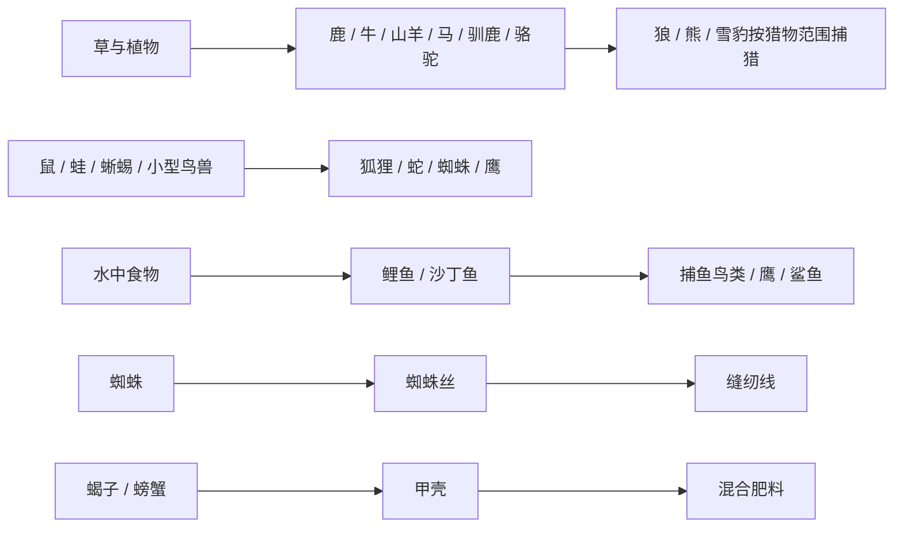

# TerraFlat 必要动物与生态补全清单

> 更新日期：2026-11-06。P0 12 种、P1 8 种均已接入正式 Actor 目录、独立外观、行为、自然生成与掉落；本轮同时补上绵羊草原生成。**35 种正式 Actor 行为树装配、20 种新增动物实际出生/贴图/回收已通过 Unity 验证；自然分布、完整行为与联机仍待验收，表中“已接入”只表示实现状态。**
>
> 目标：不为增加图鉴数量而堆动物。先补齐主要群系的**草食动物—捕食者—可获取资源**关系，再补畜牧、渔猎与有辨识度的危险生物。
>
> 本表只统计现实风格的动物；人类、幽灵、丧尸、机仆不计入。**已定义 ≠ 已在世界自然生成 ≠ 玩法全部完成**。

## 一、当前已有动物（11 种，不重复立项）

| 已有动物 | 当前身份 / 已核实的生态入口 | 仍需关注 |
| --- | --- | --- |
| 鸡 `Chicken` | 森林自然生成 | 后续可接养殖；无需再做一只“野鸡”占名额 |
| 野猪 `WildBoar` | 森林自然生成 | 家猪优先作为驯化/品种路线，不急着做全新 AI |
| 狼 `Wolf` | 森林、石地、温带草原、雪地自然生成 | 可作为新增捕食者的通用行为参考 |
| 熊 `Bear` | 森林自然生成 | 暂不增加只换外观的其他熊种 |
| 小鸟 `Bird` | 树木栖息地自然生成 | 新鸟种优先继承飞行和觅食能力 |
| 海鸥 `Seagull` | 沙滩自然生成 | 海岸还缺可采集、可捕食的水陆生物 |
| 蜜蜂 `Bee` | 已有 Actor 与蜂巢相关能力；未列入普通自然生成规则 | 核对蜂巢产生、采蜜、护巢的实际流程，不误判为缺物种 |
| 小鱼 `SmallFish` | 海洋、河流自然生成 | 目前淡水/海水共用一种小鱼，缺少鱼类层次 |
| 绵羊 `Sheep` | 本轮补入温带草原群居规则 | 剪毛/饲养能力另行验收 |
| 白兔 `Rabbit` | 雪地自然生成 | 普通草兔可先用同一物种的外观/生态变体 |
| 雪豹 `SnowLeopard` | 雪地自然生成 | 雪地缺能与其构成食物链的中型猎物 |

**本轮补全：**草原、森林、石地、沙漠、雪地、河湖、海洋、水岸与洞穴均有对应新增动物规则。草原的正式群系名为“温带草原”；湖泊水域与河流共用“河流”身份，出生仍检查真实水层。原有动物不重复立项。

## 二、P0：优先补齐的 12 种动物

> 12 种已完成首版实现；“待测”表示完整行为、自然遭遇、画面及存档生命周期尚未全部验收。

| 实现 / 验收 | 新增动物 | 主要群系 | 必须提供的差异与玩法 | 优先复用 / 注意事项 |
| --- | --- | --- | --- | --- |
| 已接入 / 待测 | **鹿** Deer | 森林、草原 | 常见中型猎物；肉、皮革；为狼/熊提供猎物 | 绵羊/白兔的觅食逃跑树；目标捕食关系需实际接通 |
| 已接入 / 待测 | **牛** Cow | 草原 | 大型草食动物；肉、皮革；后续可提供牛奶 | 先做野生觅食与掉落；挤奶/驯养不假装已实现 |
| 已接入 / 待测 | **山羊** Goat | 石地、山地边缘 | 石地可靠的肉/皮革来源；与狼形成狩猎关系 | 绵羊模板；崎岖地形可达性需验证 |
| 已接入 / 待测 | **马** `Horse` | 草原 | 快速、警觉的群居草食动物；未来承担交通 | 首版完成野生生态；捕捉、驯养、骑乘依赖独立系统 |
| 已接入 / 待测 | **狐狸** Fox | 森林、草原 | 小型捕食者；捕食小动物，和狼的威胁层次不同 | 共用追逐/捕食子树，目标体型与伤害差异由配置表达 |
| 已接入 / 待测 | **蜥蜴** Lizard | 沙漠、石地 | 填补沙漠基础小型动物；快速逃跑与少量食物 | 轻量地面移动、避险，不先加入复杂体温机制 |
| 已接入 / 待测 | **蝎子** Scorpion | 沙漠 | 沙漠近身威胁；掉落少量特殊材料 | 先复用近战；毒性若无成熟通用 Buff，先不做专用毒系统 |
| 已接入 / 待测 | **驯鹿** Reindeer | 雪地 | 雪地中型食草猎物；肉、皮革，支撑雪豹/狼捕食 | 绵羊觅食树 + 耐寒参数 |
| 已接入 / 待测 | **鲤鱼** Carp | 河流、湖泊水域 | 明确的淡水渔获；比通用小鱼更有食物价值 | 复用 `SmallFish` 水生能力；核对湖泊真实水域判断 |
| 已接入 / 待测 | **沙丁鱼** Sardine | 海洋 | 成群海鱼；海洋基础食物链与渔业资源 | 复用 `SmallFish`，差异由群体数量、体型、产出表达 |
| 已接入 / 待测 | **螃蟹** Crab | 沙滩、浅海 | 海岸近岸食物；潮间地带的可接近猎物 | 需验证水陆边缘移动；**潮汐系统非前置条件** |
| 已接入 / 待测 | **蝙蝠** Bat | 洞穴 | 填补地下动物；光照和昼夜相关的飞行遭遇 | 复用飞行框架；先核实洞穴独立出生与光照规则 |

## 三、P1：第二阶段必须补足的 8 种动物

> 8 种已与 P0 同轮接入；水陆通行、水中攻击、飞行捕猎和光照避险均复用通用能力。

| 实现 / 验收 | 新增动物 | 主要群系 | 核心用途 | 依赖 / 限制 |
| --- | --- | --- | --- | --- |
| 已接入 / 待测 | **蜘蛛** Spider | 森林、洞穴 | 小型危险生物；丝线类材料来源 | 丝线需有真实配方用途，不直接等同蚕丝 |
| 已接入 / 待测 | **青蛙** Frog | 河岸、湖岸 | 水陆交界的小猎物，连接昆虫与捕食者 | 两栖运动需抽成可复用能力；先验收岸边换位 |
| 已接入 / 待测 | **野鸭** WildDuck | 河流、湖泊 | 水鸟、蛋类或肉类资源；补齐淡水鸟类 | 可复用鸟与地面移动；涉水行为需核实 |
| 已接入 / 待测 | **蛇** Snake | 森林、石地、沙漠 | 伏击式小型威胁；让探索时需要观察地面 | 优先普通咬击；毒性作为可选 Buff 阶段 |
| 已接入 / 待测 | **骆驼** Camel | 沙漠 | 沙漠大型动物；后续可驯养、负重运输 | 先做生存环境与野生生态；载货/骑乘后做 |
| 已接入 / 待测 | **鲨鱼** Shark | 海洋 | 海洋大型捕食者，提高深水探险风险 | 需要通用**水中追击/攻击**能力，不照搬陆地狼移动 |
| 已接入 / 待测 | **鹰** Eagle | 石地、高地 | 飞行掠食者；增强高地生态和空中危险 | 共用鸟类飞行，再增加适当的捕猎行为 |
| 已接入 / 待测 | **老鼠** Rat | 草原、森林、聚落 | 小型杂食动物；后续可与农田、仓储形成关系 | 首版只自然觅食；偷吃库存不能绕开物品事务 |

**本轮范围：新增 20 种（P0 12 + P1 8），现有 11 种不计入新增数量。**统一自然出生倒计时和全局数量上限保持不变；后续按实际遭遇密度调整物种权重。

每个物种只归属于一个生成配置，多群系合并在该规则中；蜘蛛同规则覆盖阴暗森林与洞穴。规则已消除六种动物的重复归属，并修复显式洞穴维度名单被默认地表值追加的问题。

## 四、避免重复造物种与过度扩张

- **先修现有：**绵羊补草原自然生成；蜜蜂核实蜂巢来源和出入巢；小鱼、兔等可通过群系/外观变体扩展，不必复制一整套 AI。
- **家猪、家狗、草兔：**优先分别考虑野猪、狼、白兔的驯化或生态变体。驯化、跟随、繁殖、骑乘应作为独立通用玩法规划，不是新增每只动物时各做一套。
- **企鹅、海豹、海龟、鳄鱼、章鱼等：**暂不列为必需；等极地海岸、沼泽、深海或水下探索玩法明确后再评估。
- **蚕：**与已有《新增作物与食物产业链总表》的桑树—桑叶—蚕茧—丝绸工艺一起立项，不为当前野生动物数量单独加入。
- **不新增只改变颜色、伤害数字或掉落肉量的近似物种。**确实需要地区差异时，优先考虑配置、变体和群系分布。

## 五、分批验收顺序

1. **零新增阶段：**先核实绵羊草原刷新、蜜蜂蜂巢生产与旧动物真实掉落；修正“有定义却遇不到”的问题。
2. **第一批，低成本填空：**鹿、牛、山羊、驯鹿、鲤鱼、沙丁鱼。优先复用现有草食动物和鱼类行为，快速补森林、草原、石地、雪地与水域食物链。
3. **第二批，地表生态：**马、狐狸、蜥蜴、蝎子。重点检查草原群居、沙漠温度适应和攻击/逃跑层次；骑乘、毒性不阻塞生态首版。
4. **第三批，特殊栖息地：**螃蟹、蝙蝠。确认水陆交界和洞穴的自然出生支持后再接入，避免动物生成在不可移动的位置。
5. **P1 同轮实现后的验收：**检查蜘蛛、青蛙、野鸭、蛇、骆驼、鲨鱼、鹰、老鼠的实际遭遇；重点复测岸边换位、水域连通攻击和飞行俯冲。

本轮接入的主要关系（真实移动、攻击、消费与掉落仍待现场验收）：

## 六、本轮实现与验证边界

- **内容：**20 种集中在 `definitions/ecology-actors.json`，复用绵羊、狼、小鱼、鸟的外壳，每种使用独立透明像素图；不复制 20 套控制器或外壳。
- **生态：**新增 15 组规则；旧规则默认只允许 `surface`，洞穴动物显式允许 `cave`，并打开正式洞穴的自然生成。岸线要求已加载的可走陆地与真实水格，螃蟹限制浅水，鲨鱼限制深水。
- **行为：**草食群聚不创建群猎状态；狐狸不把玩家作为猎物；熊的猎物分支与对玩家的领地仇恨分开。两栖动物只由一个运动模块推进；鲨鱼追击不能跨陆地，鹰可俯冲陆生小动物，蝙蝠回避强光。
- **产出：**中大型猎物掉落肉、生皮，部分提供脂肪；蜘蛛丝可捻线，蝎子和螃蟹的甲壳可与腐殖质混成肥料。生皮沿现有处理链变为皮革。
- **后续玩法：**捕捉、驯养、挤奶、骑乘、负重、繁殖、毒性不计为本轮完成；野鸭首版只在岸上与水中活动、掉肉，不宣称已飞行或产蛋。
- **感知：**禁用物理碰撞的动物仍使用明确声明的根几何参与纯数据感知，修复鱼类对捕食者不可见的问题，不开启额外物理碰撞。
- **回归：**新增 meta 的 YAML/GUID 静态检查、22 张图片导入及 PPU 校准通过；Unity 已通过35种 Actor 树装配、20种新增动物正式出生/实际贴图/回收、生态目录237项断言、感知模板边界、自然倒计时，以及真实两栖、水中追击/开窗/受击资格、鹰捕猎、蝙蝠避光和导航收尾。鲨鱼实际扣血尚未单独断言（鹰已测伤害和击杀）。结束时控制台 Error 为0。完整 AI 快速集仍有 `wolf_attack_distance` 未通过，不能计为全量通过；各物种自然遭遇、完整产出消费、跨天存档、联机及性能仍待验收。
- **资源成本：**保留生成原图与 Alpha，20 张动物 PNG 合计约 14.69 MB；未压缩 RGBA 纹理的理论总量约 120 MiB，移动端实际加载、图集与显存峰值仍需采样，不将本轮静态检查视为性能通过。

### 每种动物的最低验收标准

- [x] **Actor 资源：**定义已通过 Manifest 加载；具有可用外壳、Sprite/Addressables、碰撞声明、生命值与必要模块，20种均已完成正式出生、实际贴图和唯一AI装配检查。
- [ ] **行为：**移动、闲逛、逃跑/攻击、觅食等至少符合定位；优先组合现有 `AnimalBehaviorTree` 公共子树，不复制物种专用控制器。
- [ ] **自然生成：**规则正确限制群系、地面或水域、光照、出生距离与生态预算；接入当前统一自然生成调度，不新增独立物种刷新时钟。
- [ ] **玩法产出：**死亡掉落、捕猎或畜牧产物有真实可用物品/配方；尚未实现的奶、骑乘、毒、繁殖等明确标“后续”，不能假完成。
- [ ] **生命周期：**出生、死亡、卸载/休眠、存档恢复与联机权威行为正常；不能突破已有数量上限或产生永久残留。
- [ ] **体验验收：**在目标群系能遇到，行为与资源符合设计；检查 Unity 控制台、画面/碰撞、帧耗时，再标记完成。

**核对入口：**

- `Assets/StreamingAssets/GameConfig/Actors/actor-manifest.json`
- `Assets/StreamingAssets/GameConfig/Actors/definitions/`
- `Assets/Resources/GameConfig/Spawners/Rules/`
- `Assets/StreamingAssets/GameConfig/WorldGeneration/NaturalItems/surface-*.json`
- 美术提示词、原图来源与导入尺寸：[AnimalEcology20261106/prompts.json](../../Tools/Art/AnimalEcology20261106/prompts.json)（内置 ImageGen 生成）。
- `.agents/skills/flatworld-ai/SKILL.md`、`.agents/skills/flatworld-map/SKILL.md`

> 更新规则：每次新增或改动一种动物，同步更新“已定义 / 可自然生成 / 已验证玩法”状态；仅在完整验收后勾选对应条目。新增候选必须说明填补哪一条生态或玩法缺口。
