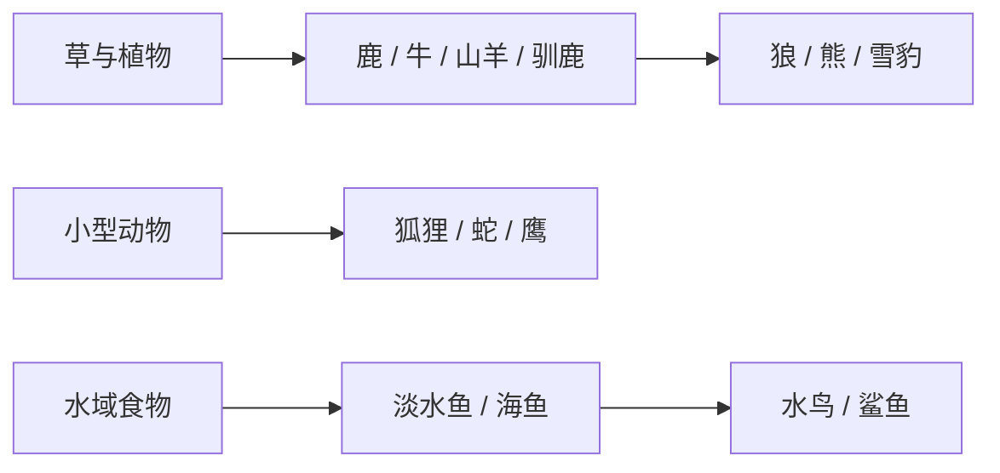

# TerraFlat 必要动物与生态补全清单

> 整理日期：2026-11-06。依据当前 `actor-manifest.json`、`definitions/*.json`、`Spawners/Rules/*.json` 和地表自然生态配置静态核对；**未进行 Unity 实机出生验证**。
>
> 目标：不为增加图鉴数量而堆动物。先补齐主要群系的**草食动物—捕食者—可获取资源**关系，再补畜牧、渔猎与有辨识度的危险生物。
>
> 本表只统计现实风格的动物；人类、幽灵、丧尸、机仆不计入。**已定义 ≠ 已在世界自然生成 ≠ 玩法全部完成**。

## 一、当前已有动物（11 种，不重复立项）

| 已有动物 | 当前身份 / 已核实的生态入口 | 仍需关注 |
| --- | --- | --- |
| 鸡 `Chicken` | 森林自然生成 | 后续可接养殖；无需再做一只“野鸡”占名额 |
| 野猪 `WildBoar` | 森林自然生成 | 家猪优先作为驯化/品种路线，不急着做全新 AI |
| 狼 `Wolf` | 森林、石地自然生成 | 可作为新增捕食者的通用行为参考 |
| 熊 `Bear` | 森林自然生成 | 暂不增加只换外观的其他熊种 |
| 小鸟 `Bird` | 树木栖息地自然生成 | 新鸟种优先继承飞行和觅食能力 |
| 海鸥 `Seagull` | 沙滩自然生成 | 海岸还缺可采集、可捕食的水陆生物 |
| 蜜蜂 `Bee` | 已有 Actor 与蜂巢相关能力；未列入普通自然生成规则 | 核对蜂巢产生、采蜜、护巢的实际流程，不误判为缺物种 |
| 小鱼 `SmallFish` | 海洋、河流自然生成 | 目前淡水/海水共用一种小鱼，缺少鱼类层次 |
| 绵羊 `Sheep` | 已有 Actor 定义；**未见普通自然生成规则** | **优先补草原野生种群**，剪毛/饲养能力另行验收 |
| 白兔 `Rabbit` | 雪地自然生成 | 普通草兔可先用同一物种的外观/生态变体 |
| 雪豹 `SnowLeopard` | 雪地自然生成 | 雪地缺能与其构成食物链的中型猎物 |

**当前主要缺口：**草原已有地表生态配置，但现有普通动物生成规则未覆盖草原；沙漠缺现实动物；石地缺草食动物；海洋/河流只有通用小鱼；洞穴缺专属的普通动物规则。以上结论仅针对本次检查到的配置，不代表这些环境中绝对无法通过事件或其他系统生成生物。

## 二、P0：优先补齐的 12 种动物

> 这些动物承担基础生态或生存资源功能。`[ ]` 表示尚未完成，按“能进入世界并产生对应玩法”验收，而不是只创建 JSON。

| 完成 | 新增动物 | 主要群系 | 必须提供的差异与玩法 | 优先复用 / 注意事项 |
| --- | --- | --- | --- | --- |
| [ ] | **鹿** | 森林、草原 | 常见中型猎物；肉、皮革；为狼/熊提供猎物 | 绵羊/白兔的觅食逃跑树；目标捕食关系需实际接通 |
| [ ] | **牛** | 草原 | 大型草食动物；肉、皮革；后续可提供牛奶 | 先做野生觅食与掉落；挤奶/驯养不假装已实现 |
| [ ] | **山羊** | 石地、山地边缘 | 石地可靠的肉/皮革来源；与狼形成狩猎关系 | 绵羊模板；崎岖地形可达性需验证 |
| [ ] | **马** | 草原 | 快速、警觉的群居草食动物；未来承担交通 | 第一阶段仅生态与捕捉；**骑乘依赖独立系统** |
| [ ] | **狐狸** | 森林、草原 | 小型捕食者；捕食小动物，和狼的威胁层次不同 | 共用追逐/捕食子树，目标体型与伤害差异由配置表达 |
| [ ] | **蜥蜴** | 沙漠、石地 | 填补沙漠基础小型动物；快速逃跑与少量食物 | 轻量地面移动、避险，不先加入复杂体温机制 |
| [ ] | **蝎子** | 沙漠 | 沙漠近身威胁；掉落少量特殊材料 | 先复用近战；毒性若无成熟通用 Buff，先不做专用毒系统 |
| [ ] | **驯鹿** | 雪地 | 雪地中型食草猎物；肉、皮革，支撑雪豹/狼捕食 | 绵羊觅食树 + 耐寒参数 |
| [ ] | **鲤鱼** | 河流、湖泊水域 | 明确的淡水渔获；比通用小鱼更有食物价值 | 复用 `SmallFish` 水生能力；核对湖泊真实水域判断 |
| [ ] | **沙丁鱼** | 海洋 | 成群海鱼；海洋基础食物链与渔业资源 | 复用 `SmallFish`，差异由群体数量、体型、产出表达 |
| [ ] | **螃蟹** | 沙滩、浅海 | 海岸近岸食物；潮间地带的可接近猎物 | 需验证水陆边缘移动；**潮汐系统非前置条件** |
| [ ] | **蝙蝠** | 洞穴 | 填补地下动物；光照和昼夜相关的飞行遭遇 | 复用飞行框架；先核实洞穴独立出生与光照规则 |

## 三、P1：第二阶段必须补足的 8 种动物

> P0 能稳定出生后再做；这些动物提高玩法丰富度，但可能需要补充**通用能力**，不应为单一物种硬写专用系统。

| 完成 | 新增动物 | 主要群系 | 核心用途 | 依赖 / 限制 |
| --- | --- | --- | --- | --- |
| [ ] | **蜘蛛** | 森林、洞穴 | 小型危险生物；丝线类材料来源 | 丝线需有真实配方用途，不直接等同蚕丝 |
| [ ] | **青蛙** | 河岸、湖岸 | 水陆交界的小猎物，连接昆虫与捕食者 | 两栖运动需抽成可复用能力；先验收岸边换位 |
| [ ] | **野鸭** | 河流、湖泊 | 水鸟、蛋类或肉类资源；补齐淡水鸟类 | 可复用鸟与地面移动；涉水行为需核实 |
| [ ] | **蛇** | 森林、石地、沙漠 | 伏击式小型威胁；让探索时需要观察地面 | 优先普通咬击；毒性作为可选 Buff 阶段 |
| [ ] | **骆驼** | 沙漠 | 沙漠大型动物；后续可驯养、负重运输 | 先做生存环境与野生生态；载货/骑乘后做 |
| [ ] | **鲨鱼** | 海洋 | 海洋大型捕食者，提高深水探险风险 | 需要通用**水中追击/攻击**能力，不照搬陆地狼移动 |
| [ ] | **鹰** | 石地、高地 | 飞行掠食者；增强高地生态和空中危险 | 共用鸟类飞行，再增加适当的捕猎行为 |
| [ ] | **老鼠** | 草原、森林、聚落 | 小型杂食动物；后续可与农田、仓储形成关系 | 首版只自然觅食；偷吃库存不能绕开物品事务 |

**规模边界：新动物总候选为 20 种（P0 12 + P1 8），不是一次性全部开发任务。**现有 11 种不计入新增数量；完成 P0 后先评估生态密度和性能，再决定 P1 的排期。

## 四、避免重复造物种与过度扩张

- **先修现有：**绵羊补草原自然生成；蜜蜂核实蜂巢来源和出入巢；小鱼、兔等可通过群系/外观变体扩展，不必复制一整套 AI。
- **家猪、家狗、草兔：**优先分别考虑野猪、狼、白兔的驯化或生态变体。驯化、跟随、繁殖、骑乘应作为独立通用玩法规划，不是新增每只动物时各做一套。
- **企鹅、海豹、海龟、鳄鱼、章鱼等：**暂不列为必需；等极地海岸、沼泽、深海或水下探索玩法明确后再评估。
- **蚕：**与已有《新增作物与食物产业链总表》的桑树—桑叶—蚕茧—丝绸工艺一起立项，不为当前野生动物数量单独加入。
- **不新增只改变颜色、伤害数字或掉落肉量的近似物种。**确实需要地区差异时，优先考虑配置、变体和群系分布。

## 五、推荐实施顺序

1. **零新增阶段：**先核实绵羊草原刷新、蜜蜂蜂巢生产与旧动物真实掉落；修正“有定义却遇不到”的问题。
2. **第一批，低成本填空：**鹿、牛、山羊、驯鹿、鲤鱼、沙丁鱼。优先复用现有草食动物和鱼类行为，快速补森林、草原、石地、雪地与水域食物链。
3. **第二批，地表生态：**马、狐狸、蜥蜴、蝎子。重点检查草原群居、沙漠温度适应和攻击/逃跑层次；骑乘、毒性不阻塞生态首版。
4. **第三批，特殊栖息地：**螃蟹、蝙蝠。确认水陆交界和洞穴的自然出生支持后再接入，避免动物生成在不可移动的位置。
5. **生态稳定后做 P1：**按现有游戏玩法缺口选蜘蛛、青蛙、野鸭、蛇、骆驼、鲨鱼、鹰、老鼠，不为凑数量强制同期实现。

目标食物链（**设计方向，非当前已实装的完整捕食关系**）：

## 六、每种动物的最低完成标准

- [ ] **Actor 资源：**定义已通过 Manifest 加载；具有可用外壳、Sprite/Addressables、碰撞体、生命值与必要模块，不能只是表里有名字。
- [ ] **行为：**移动、闲逛、逃跑/攻击、觅食等至少符合定位；优先组合现有 `AnimalBehaviorTree` 公共子树，不复制物种专用控制器。
- [ ] **自然生成：**规则正确限制群系、地面或水域、光照、出生距离与生态预算；接入当前统一自然生成调度，不新增独立物种刷新时钟。
- [ ] **玩法产出：**死亡掉落、捕猎或畜牧产物有真实可用物品/配方；尚未实现的奶、骑乘、毒、繁殖等明确标“后续”，不能假完成。
- [ ] **生命周期：**出生、死亡、卸载/休眠、存档恢复与联机权威行为正常；不能突破已有数量上限或产生永久残留。
- [ ] **体验验收：**在目标群系能遇到，行为与资源符合设计；检查 Unity 控制台、画面/碰撞、帧耗时，再标记完成。

**核对入口：**

- `Assets/StreamingAssets/GameConfig/Actors/actor-manifest.json`
- `Assets/StreamingAssets/GameConfig/Actors/definitions/`
- `Assets/Resources/GameConfig/Spawners/Rules/`
- `Assets/StreamingAssets/GameConfig/WorldGeneration/NaturalItems/surface-*.json`
- `.agents/skills/flatworld-ai/SKILL.md`、`.agents/skills/flatworld-map/SKILL.md`

> 更新规则：每次新增或改动一种动物，同步更新“已定义 / 可自然生成 / 已验证玩法”状态；仅在完整验收后勾选对应条目。新增候选必须说明填补哪一条生态或玩法缺口。
