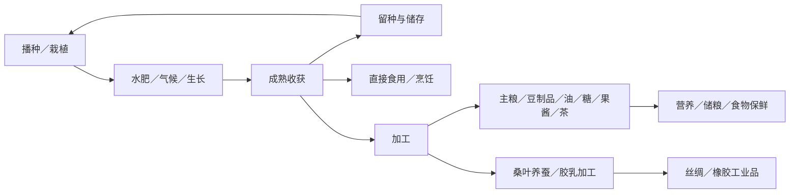

# TerraFlat 必要新增作物与食物产业链总表（最小候选）

> 2026-11-06 依据项目现有物品记录与 `03_生存制作与农业/食物.md` 整理。
> **状态：2026-11-06 已配置前两批 10 种食用作物、种子、食材和基础加工，游戏内流程尚待验证。** 桑树、橡胶树仍按下游产业接入后再做；豆油可用于煎土豆；豆粕饲料用途尚未接入。本文仍保留完整的设计目标与阶段边界。
> 新增野生草莓和种子使用新世界的生态规则；旧世界保留冻结的生态配置，不会自动补充这些自然生成来源。 茶树种子目前仅通过自然探索获得，采叶不会返还种子。
> 候选从最初 198 种、上轮 56 种缩减为 **12 种**；目标是用尽量少的新增作物支撑核心食物与工业加工。

## 一、为什么只保留这 12 种

- **不重复现有内容**：现有水稻、萝卜、辣椒、棉花、浆果、蘑菇，以及苹果、桃、橘、椰子等，不再列为新增项。
- **优先补齐已存在的下游**：已有 `Flour`（面粉）、`Tea`（茶）、`Silk`（丝绸），保留小麦、茶树、桑树，补上生产来源。
- **尊重已有食物策划**：`食物.md` 提到的小麦、草莓、西瓜、南瓜继续保留；水稻已有，不重复新增。
- **一类用途选一个代表**：食用油由大豆承担，基础淀粉由小麦／玉米／马铃薯承担；普通叶菜、香草、其他谷物、坚果、菌菇等不再为“换一种味道”单列物品和种植链。
- **特殊资源须打开独立产线**：保留甘蔗制糖、桑树养蚕、橡胶树产胶；其余复杂工业作物先不做。

## 二、最终保留总览

| 类别 | 数量 | 核心目的 |
|---|---:|---|
| 主粮、蛋白与油脂 | 4 | 主食、豆制品、食用油、饲料 |
| 常见蔬果 | 4 | 烹饪、保鲜、补水、野生驯化 |
| 必要加工链上游 | 3 | 制糖、制茶、养蚕 |
| 工业原料 | 1 | 天然橡胶 |
| **合计** | **12** | **不再为凑类别增加作物** |

## 三、12 种作物的核心玩法

> 以下是**计划实现的玩法**，不是现有代码已支持的全部功能。每种作物都应有“种植／获取 → 玩家决定如何分配 → 加工或使用 → 获得不同收益”的循环；普通加工优先复用配方和物品数据。除 `食物.md` 已提出的生长与营养方向外，具体产量、时间、营养值和腐败期限均待平衡。

### 01 主粮、蛋白与油脂（4 种）

#### 小麦｜长期储粮与制粉

- **获取与培养**：需要投入较长生长时间，麦粒适合储存；让玩家规划粮田和库存，而非种完立刻获得大量即食物。
- **玩家循环**：播种 → 照料水肥 → 收麦 → 留下一部分作下轮种子 → 其余储存或磨成面粉 → 制作面包、面条等主食。
- **关键选择**：马上加工为易用食物，还是储存麦粒等待缺粮时再处理？与已有水稻形成“不同耕种环境、相似主粮定位”的替代选择，不额外开发第二套面粉系统。

#### 玉米｜食物与饲料争夺同一份收成

- **获取与培养**：作为普通田地作物，成熟后一次收获玉米，不为甜玉米、饲料玉米再拆新品种。
- **玩家循环**：采收 → 煮／烤成简易食物，或磨粉／提取淀粉；畜牧接入后，也可直接投入饲料配方。
- **关键选择**：收成用来维持玩家口粮，还是用于牲畜生产？畜牧尚未接入时，先实现食用和制粉，不为了玉米提前建造独立饲养系统。

#### 大豆（黄豆）｜一份原料，蛋白和油脂两条路线

- **获取与培养**：田间收获豆粒，保留种子后统一进入食品加工体系。
- **玩家循环**：大豆 → 豆浆／豆腐，提供蛋白类食物；或大豆 → 压榨 → 豆油＋豆粕，油进入烹饪，豆粕后续进入饲料。
- **关键选择**：同一批豆子做蛋白食物还是榨油？食用油和饲料副产物都由真实配方产出，不能凭空复制原料；酱油等发酵食品可在基础路线完成后扩展。

#### 马铃薯（土豆）｜无需复杂设备的备用主粮

- **获取与培养**：通过普通耕地生长块茎，收获后得到可直接烹饪的高碳水原料；承担与小麦不同的生存阶段。
- **玩家循环**：挖薯 → 烤制／炖煮，快速补充口粮；后续有加工条件时，可制淀粉并参与其他食谱。
- **关键选择**：缺粮时简单加热直接吃，还是囤积等待批量加工？不加入额外的“发芽毒性”等专属状态，难度主要来自种植周期与食物储备。

### 02 常见蔬果（4 种）

#### 番茄｜鲜食与保鲜加工

- **获取与培养**：普通蔬果田提供烹饪配料，不把番茄再拆成多个颜色、形状品种。
- **玩家循环**：收获 → 直接食用或加入汤、炖菜；富余番茄 → 加工成番茄酱 → 用于更复杂的料理。
- **关键选择**：趁新鲜使用，还是花费加工时间换更易储备的酱料？通过既有腐败时间与配方数据形成区别，不做独立“番茄酱机器”。

#### 南瓜｜慢产出的耐储口粮

- **获取与培养**：沿用 `食物.md` 的长生长周期、高碳水和维生素定位；成熟后提供值得囤积的整份收成。
- **玩家循环**：长期照料 → 收获 → 留种 → 蒸煮或做南瓜汤；多余收成储存，畜牧阶段再接饲料。
- **关键选择**：占用耕地较久换取储备粮，还是改种更偏日常周转的蔬果？它的价值是稳定备粮，不是额外制造大量南瓜口味菜谱。

#### 西瓜｜田里种出的“补水物资”

- **获取与培养**：鲜食水分高、碳水少，突出 `食物.md` 规划的水分补给特性，而非替代主粮。
- **玩家循环**：播种 → 收获 → 炎热、缺水或劳作时食用补水；富余瓜果可分享或短期储存。
- **关键选择**：带着占重量与体积的西瓜移动，还是使用更便于运输的装水容器？仅通过已有食物水分、负重、腐败机制体现差异，不引入新的解渴 Buff。

#### 草莓｜野生采集到驯化种植

- **获取与培养**：先在野外发现野草莓并留种，再获得可耕种的草莓；与已有泛用浆果的区别在于明确的驯化目标。
- **玩家循环**：野采 → 留种 → 培育栽培草莓 → 反复收果 → 鲜食或与糖加工成果酱。
- **关键选择**：前期靠探索零星收获，还是投入田地建设长期果源？按 `食物.md` 的意图，**栽培草莓生长周期目标为野草莓的 50%**；先考虑通过种子／作物数据变体达成，不做通用遗传育种系统，具体收果周期待验证。

### 03 必要加工链上游（3 种）

#### 甘蔗｜把田地收成变成糖

- **获取与培养**：占用耕地生产糖料；不再额外加入其他甜味作物。
- **玩家循环**：收甘蔗 → 压榨／熬制 → 糖、糖蜜 → 果酱、甜食，以及后续发酵配方；蔗渣可作为加工副产物，必要时再接燃料。
- **关键选择**：有限收成优先供日常食品，还是积攒用于大量甜食和加工？若制作环节需要甘蔗汁，只能走正式液体容器／机器链，或在单步配方内结算，不虚构可随意堆叠的液体物品。

#### 茶树｜一次种下，多次采摘的加工资源

- **获取与培养**：多年生茶树成长期有投入，成熟后规划按周期采收茶叶；不是每次摘叶就砍掉一棵树。
- **玩家循环**：培育茶树 → 定期摘鲜叶 → 加工为茶叶 → 烹煮／冲泡成现有 `Tea` 方向的茶饮。
- **关键选择**：把土地留给立即收获的食物，还是经营长期反复生产的茶园？首版只需一条制茶路线，不因绿茶、红茶品种增加新作物；持续采叶复用已有持续产出思路，实际支持情况须实现时核实。

#### 桑树｜果实用于生存，叶子接入纺织

- **获取与培养**：作为多年生树木管理，一株树服务两种用途，不再专门加入一堆重复果树。
- **玩家循环**：栽桑树 → 采桑葚作食物／果干，同时收集桑叶 → 养蚕消耗桑叶 → 取得蚕茧 → 缫丝，补齐已有 `Silk` 的生产来源。
- **关键选择**：先用桑葚补充食物，还是长期留树生产桑叶、发展丝绸？**桑叶不能直接合成丝绸**；养蚕及缫丝是后续配套玩法，在其实现前，桑树只提供原料，不假装已闭环。

### 04 工业原料（1 种）

#### 橡胶树｜长期经营的工业采集点

- **获取与培养**：只能在适宜环境培育并等待树木成熟，工业阶段才有较强需求，避免前期抢占基础粮食玩法。
- **玩家循环**：种树／护树 → 成熟后间隔采胶 → 胶乳加工为天然橡胶 → 进入轮胎、密封件等配方。
- **关键选择**：保留成熟树持续采胶，还是砍伐取得一次性木材并失去长期胶源？周期性采胶优先复用持续产出和收获逻辑；胶乳若作为液体流转，必须接正式容器／加工端口，不另建专用库存液体规则。

## 四、共用生产循环与跨产业链连接

- **生存粮食闭环**：小麦／马铃薯承担碳水储备；大豆承担蛋白和油脂；西瓜承担鲜食补水。不同用途用现有营养、水分、腐败、重量、体积参数表达，不给每种作物独立 Buff。
- **保存与加工闭环**：番茄收成做酱、草莓配甘蔗糖做果酱；花费加工时间换取更稳定的食物储备。是否延长保质期由实际食品配置决定，不默认所有加工都会保鲜。
- **畜牧闭环（待下游接入）**：玉米可作为饲料，大豆压榨后的豆粕可补充饲料蛋白；尚未有饲养路线时不强行增加牲畜或新设施。
- **下游产业闭环（后续）**：茶树补齐茶饮来源；桑叶→蚕茧→丝绸；胶乳→天然橡胶→工业配方。产业链所需下游工序单独设计，不把它们算成新作物。

## 五、实现边界和阶段

- **首批：可直接体验种植与烹饪**：小麦、玉米、大豆、马铃薯、番茄、南瓜、西瓜、草莓。最小验收为可获取种子、真实播种成长、收获留种、至少一种能使用的食物／配方；草莓另验证野采与栽培差异。
- **第二批：轻量加工**：甘蔗、茶树。首批只要糖和茶饮的基础产出成立，不急着做大量风味、品质等级或酿造分支。
- **产业接入后：长期工业树**：桑树、橡胶树。只有丝绸／橡胶确实进入可用工业配方，再完成其生产线；可先规划数据，不提前堆无用途物品。
- **通用农业规则**：尽量复用耕地、水肥、世界时间、植物生长、成熟收获与持续采果；作物用配置表达周期、产量、适宜气候、反复采收资格，必要时才新增通用能力。
- **事务与实体边界**：种子、作物实体、收获原料、加工产物身份分离；播种与加工走真实扣料／产物交付事务。桑叶、胶乳和果实的持续采收不能每次摧毁母株。
- **验收与范围**：每个品种需要物品 ID、营养／腐败、外观、生态或播种、加工配方、存档与测试。未知参数保持待定；本表是设计目标，不把规划描述为已经实装。

## 六、不在本轮新增的内容

其他粮食、豆类、食用油原料、蔬果、坚果、香辛料、药草、纤维植物、水生植物和专用品种菌菇，**全部移出当前候选**。确实需要更多口味时，优先复用现有食材分类、通用菜谱与物品变体；只有未来出现明确的新玩法需求，再单独提出，不预留“可能会用到”的新增名单。
