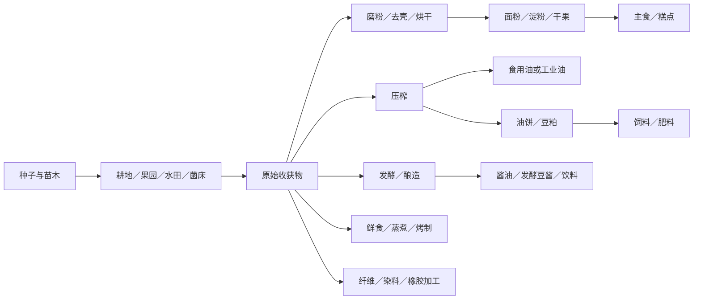

# TerraFlat 缺失作物与食物产业链总表（策划候选）

> 2026-11-06 基于当前项目 `Assets/StreamingAssets/GameConfig/Items/shells/*.json`、`Items/item-manifest.json`、自然生态规则与 `03_生存制作与农业/食物.md` 核对。
> **状态：候选清单，不等于已新增进游戏。** “缺失”是指当前未发现这些名称对应的独立种植/生产作物定义；可能已有下游成品（例如面粉、茶）。现实中的作物和栽培品种数远超本表，本表只覆盖适合 TerraFlat 的常见、代表性食用/工业作物、若干特殊资源。

## 一、现有种类（本表不重复当作缺失）

- 已有常见农作物/自然可采：水稻、萝卜、辣椒、棉花、浆果、蘑菇、藤蔓、仙人掌、药草、狗尾草。
- 已有果实/果树：苹果、桃、橘、椰子；已有柳、松、橡树。现有植物的播种、生态生成与可采形态并不完全一致。
- 已有下游而缺上游：`Flour` 面粉、`Tea` 茶、`Silk` 丝绸；所以“小麦”“茶树”“桑树”仍在本表。
- `食物.md` 曾提出小麦、草莓、西瓜、南瓜与水稻；其中水稻已实装，其余仍只见策划意图。
- 白/黑芝麻、黑/黄大豆、彩色甜椒、哈密瓜/其他甜瓜、油麦菜/其他生菜属于可共用主种植身份的栽培品种，优先做品种数据变体而非重复造整套逻辑。

## 二、缺失候选总览

**共 198 种代表性候选，分 14 类**（以本表每一行算一类；“作物”包含可规模种植果树和特殊养殖资源，并非全为耕地农作物）。

| 类别 | 候选数 |
|---|---:|
| 谷物与伪谷物 | 12 |
| 豆类与荚菜 | 13 |
| 油料与油脂树 | 10 |
| 根茎与块茎 | 13 |
| 叶菜、花菜与葱蒜 | 19 |
| 果菜与瓜类 | 14 |
| 果树、藤本与浆果 | 31 |
| 坚果与干果树 | 8 |
| 糖料、饮料与酿造原料 | 8 |
| 香辛料与厨房香草 | 21 |
| 草药、花卉与特殊用途植物 | 14 |
| 纤维、染料与工业经济植物 | 15 |
| 水生作物与藻类养殖 | 10 |
| 专用品种菌菇与共生真菌 | 10 |
| **合计** | **198** |

## 三、逐类新增清单与加工功能

### 01 谷物与伪谷物

| 待新增作物 | 核心功能／产物用途 |
|---|---|
| 小麦 | 磨面粉→面包、面条、馒头；麸皮作饲料 |
| 大麦 | 制麦芽→酿造；麦饭、饲料 |
| 燕麦 | 燕麦片、粥、植物饮品、饲料 |
| 玉米 | 鲜食、玉米粉、淀粉、玉米油、饲料、乙醇 |
| 黑麦 | 黑麦粉、黑面包、麦芽 |
| 高粱 | 高粱米、酿造、秸秆燃料或饲料 |
| 粟（小米） | 小米粥、米糕、储备口粮 |
| 黍（黄米） | 黄米糕、酿造、耐旱粮 |
| 荞麦 | 荞麦粉、面条、蜜源 |
| 藜麦 | 高蛋白杂粮、营养配餐 |
| 薏苡（薏米） | 谷物粥、食品加工 |
| 籽粒苋 | 籽粒磨粉、嫩叶食用 |

### 02 豆类与荚菜

| 待新增作物 | 核心功能／产物用途 |
|---|---|
| 大豆（黄豆） | 豆浆、豆腐、发酵豆酱、酱油、豆油；豆粕作饲料 |
| 绿豆 | 绿豆汤、豆芽、淀粉粉丝 |
| 红小豆 | 豆沙、红豆糕、甜汤 |
| 豌豆 | 鲜食、豌豆粉、豌豆蛋白、饲料 |
| 蚕豆 | 熟豆、豆瓣酱、发酵食品 |
| 菜豆（芸豆／四季豆） | 鲜荚熟食、干豆储粮；需要熟制 |
| 豇豆（长豆角） | 鲜食、干豆角、腌菜 |
| 鹰嘴豆 | 豆泥、豆粉、植物蛋白餐 |
| 兵豆（小扁豆） | 豆汤、扁豆粉、耐储蛋白 |
| 利马豆 | 熟豆、炖菜；需充分熟制 |
| 扁豆（藊豆） | 食荚熟食、干豆；需充分熟制 |
| 刀豆 | 熟制蔬菜、腌菜；禁止直接生食 |
| 羽扇豆（食用型） | 脱苦后加工高蛋白食品；需加工资格 |

### 03 油料与油脂树

| 待新增作物 | 核心功能／产物用途 |
|---|---|
| 花生 | 花生油、烤花生、花生酱、花生粕 |
| 油菜 | 菜籽油、油菜嫩叶、菜籽饼 |
| 向日葵 | 葵花籽、葵花籽油、籽饼 |
| 芝麻 | 香油、芝麻酱、糕点、芝麻饼 |
| 亚麻 | 亚麻籽、亚麻籽油、亚麻纤维 |
| 红花 | 红花籽油、染料、花材 |
| 紫苏 | 紫苏籽油、可食嫩叶、香料 |
| 油橄榄 | 橄榄果、橄榄油、腌橄榄 |
| 油棕 | 棕榈果、棕榈油、工业油脂 |
| 油茶树（山茶油树） | 油茶籽压榨茶油；不同于饮料茶树 |

### 04 根茎与块茎

| 待新增作物 | 核心功能／产物用途 |
|---|---|
| 马铃薯（土豆） | 烤土豆、薯条、淀粉、酒精原料 |
| 甘薯（红薯） | 烤红薯、粉条、淀粉、饲料 |
| 木薯 | 制粉、木薯淀粉、珍珠原料；食用前脱毒加工 |
| 芋头 | 芋泥、炖菜、甜品 |
| 山药 | 蒸煮、面粉、药膳类游戏配方 |
| 胡萝卜 | 生食、炖菜、维生素来源 |
| 甜菜（食用／糖用品种） | 甜菜根食用；糖用甜菜制糖 |
| 牛蒡 | 根菜、汤料、腌制 |
| 菊芋（洋姜） | 块茎食品、糖类加工 |
| 芜菁 | 根菜、冬季储备粮、饲料 |
| 葛根 | 根部淀粉、葛粉 |
| 竹芋 | 淀粉提取、细粉食品 |
| 欧洲防风草 | 耐寒根菜、炖菜 |

### 05 叶菜、花菜与葱蒜

| 待新增作物 | 核心功能／产物用途 |
|---|---|
| 大白菜 | 炒菜、汤、泡菜、酸菜 |
| 小白菜 | 快熟叶菜、炒菜、汤 |
| 甘蓝（卷心菜） | 沙拉、炒菜、酸菜 |
| 羽衣甘蓝 | 叶菜、营养配餐 |
| 抱子甘蓝 | 烤菜、炖菜 |
| 菠菜 | 鲜菜、汤、蔬菜配餐 |
| 生菜（含油麦菜品种） | 沙拉、三明治、蔬菜卷 |
| 芹菜 | 汤底、炖菜、香味配料 |
| 韭菜 | 馅料、炒蛋、蔬菜菜品 |
| 大葱 | 调味、汤底、炒菜 |
| 洋葱 | 炒香底料、炖菜、保存调味品 |
| 大蒜 | 香料、腌制、蒜泥 |
| 芦笋 | 烤菜、汤、精品蔬菜 |
| 西兰花 | 蒸菜、炒菜、营养餐 |
| 花椰菜（菜花） | 炒菜、焗烤、蔬菜泥 |
| 空心菜 | 叶菜、快炒 |
| 茼蒿 | 火锅、菜汤 |
| 苋菜（叶用） | 叶菜、色素、煮汤 |
| 菊苣 | 叶菜、苦味沙拉、根部烘焙饮品 |

### 06 果菜与瓜类

| 待新增作物 | 核心功能／产物用途 |
|---|---|
| 番茄 | 番茄酱、沙司、浓汤、披萨配料 |
| 黄瓜 | 生食、腌黄瓜、沙拉 |
| 茄子 | 烧烤、焖菜、茄泥 |
| 甜椒（彩椒） | 与现有辣椒区分的低辣品种；炒菜、沙拉 |
| 南瓜 | 南瓜汤、南瓜派、籽仁、动物饲料 |
| 西葫芦 | 炒菜、炖菜 |
| 冬瓜 | 汤、耐储蔬菜 |
| 丝瓜 | 嫩瓜食用；老熟果制洗刷纤维 |
| 苦瓜 | 熟食、特色苦味菜 |
| 葫芦（瓠瓜） | 嫩果食用；老熟外壳可制容器 |
| 秋葵 | 黏性蔬菜、浓汤、腌菜 |
| 佛手瓜 | 炒菜、炖菜 |
| 西瓜 | 高水分鲜食、果汁、瓜籽 |
| 甜瓜（含哈密瓜品种） | 高水分甜果、切盘、果汁 |

### 07 果树、藤本与浆果

| 待新增作物 | 核心功能／产物用途 |
|---|---|
| 草莓 | 鲜果、果酱、甜点；可设计野生驯化与栽培提速 |
| 葡萄 | 鲜果、葡萄干、葡萄汁、酿造 |
| 蓝莓 | 鲜食、果酱、烘焙 |
| 覆盆子（树莓） | 果酱、果汁、甜点 |
| 黑莓 | 浆果采集、果酱、酿造 |
| 蔓越莓 | 酸味果酱、饮品、耐储干果 |
| 樱桃 | 鲜果、糖渍、甜品 |
| 梨 | 鲜果、果脯、梨汁 |
| 李子 | 鲜果、梅干、果酱 |
| 杏 | 鲜果、杏干、果酱 |
| 柿子 | 鲜食、柿饼、干果 |
| 石榴 | 鲜果、石榴汁、糖浆 |
| 无花果 | 鲜果、果干、果酱 |
| 猕猴桃 | 鲜食、果汁、酸味甜点 |
| 柠檬 | 酸味调味、柠檬水、腌制 |
| 青柠 | 酸味饮品、料理调味 |
| 柚子 | 鲜果、果皮蜜饯、果茶 |
| 金橘 | 可连皮食用、蜜饯、果酱 |
| 香蕉 | 鲜果、香蕉干、蛋糕、淀粉 |
| 菠萝 | 鲜果、罐藏、果汁 |
| 芒果 | 鲜果、芒果干、果酱 |
| 牛油果 | 高脂果肉、酱料、植物油 |
| 番木瓜 | 鲜果、果干、嫩果炖菜 |
| 荔枝 | 鲜果、罐藏、果干 |
| 龙眼 | 鲜果、桂圆干 |
| 枣树（红枣） | 鲜枣、红枣干、甜汤 |
| 火龙果 | 鲜果、果汁 |
| 百香果 | 果浆、果汁、浓缩酸味糖浆 |
| 山楂 | 山楂片、果酱、酸味甜点 |
| 番石榴 | 鲜果、果汁、果酱 |
| 桑树（桑葚） | 桑葚果、桑叶饲蚕→蚕丝链 |

### 08 坚果与干果树

| 待新增作物 | 核心功能／产物用途 |
|---|---|
| 核桃树 | 核桃仁、坚果油、木材 |
| 板栗树 | 栗子熟食、栗子粉、糖炒栗子 |
| 榛树 | 榛子、坚果酱、烘焙 |
| 扁桃树（杏仁） | 杏仁、杏仁饮品、糕点 |
| 腰果树 | 熟制腰果仁、坚果食品 |
| 开心果树 | 烘烤坚果、甜品 |
| 澳洲坚果树（夏威夷果） | 坚果仁、坚果油 |
| 碧根果树（美国山核桃） | 坚果、坚果糖、油脂 |

### 09 糖料、饮料与酿造原料

| 待新增作物 | 核心功能／产物用途 |
|---|---|
| 甘蔗 | 榨甘蔗汁→蔗糖、糖蜜、乙醇；蔗渣燃料 |
| 茶树（饮料茶） | 鲜茶叶→绿茶／红茶等；现有茶饮品补齐上游 |
| 咖啡树 | 咖啡果→咖啡豆→烘焙咖啡 |
| 可可树 | 可可豆→可可粉、可可脂、巧克力 |
| 啤酒花 | 啤酒香苦原料、酿造加工 |
| 甜叶菊 | 甜味叶、甜味提取物 |
| 罗汉果 | 甜味果干、草本饮品 |
| 可乐果树 | 可乐果、饮料调味 |

### 10 香辛料与厨房香草

| 待新增作物 | 核心功能／产物用途 |
|---|---|
| 生姜 | 姜片、姜汁、香料粉、糖姜 |
| 姜黄 | 黄颜色香料、咖喱、染色 |
| 黑胡椒 | 胡椒粒、胡椒粉、通用香辛料 |
| 花椒 | 麻味香料、花椒油 |
| 八角 | 卤料、香辛料 |
| 肉桂树 | 肉桂皮、肉桂粉、甜品香料 |
| 丁香树 | 干花蕾香料、卤料 |
| 小茴香 | 种子香料、汤料 |
| 孜然 | 烧烤香料、调味粉 |
| 芫荽（香菜） | 香菜叶、芫荽籽双产出 |
| 罗勒 | 意式香草、青酱 |
| 欧芹 | 香草、汤料、配菜 |
| 迷迭香 | 烤肉香草、香料油 |
| 百里香 | 炖菜香草、烤肉调味 |
| 牛至 | 披萨与番茄酱香料 |
| 莳萝 | 腌菜、鱼肉调味 |
| 薄荷 | 薄荷茶、饮料、甜点 |
| 香茅 | 香草茶、东南亚料理香料 |
| 豆蔻 | 香料、甜点与咖喱 |
| 藏红花 | 花柱香料、天然着色 |
| 芥菜（籽用） | 芥末籽→芥末酱；嫩叶可作蔬菜 |

### 11 草药、花卉与特殊用途植物

| 待新增作物 | 核心功能／产物用途 |
|---|---|
| 芦荟 | 叶肉、游戏内药膏原料、护肤品材料 |
| 薰衣草 | 香包、香料、香水材料 |
| 洋甘菊 | 草本茶、香气配料 |
| 金盏花 | 染料、花材、游戏内药膏材料 |
| 菊花 | 菊花茶、观赏花、染色 |
| 金银花 | 花材、草本茶、游戏内药剂材料 |
| 艾草 | 草本香料、熏香、游戏内药材 |
| 甘草 | 甜味根、草本配料 |
| 人参 | 高价值草药、游戏内药剂素材 |
| 黄芪 | 根药材、游戏内药剂素材 |
| 枸杞 | 浆果、药膳类料理 |
| 蒲公英 | 野菜、根饮品、野生采集 |
| 紫锥菊 | 观赏花、游戏内药剂素材 |
| 百合 | 可食鳞茎、鲜花、料理 |

### 12 纤维、染料与工业经济植物

| 待新增作物 | 核心功能／产物用途 |
|---|---|
| 竹子 | 竹笋、竹材、竹纤维、建筑 |
| 黄麻 | 麻袋、绳索、粗纤维 |
| 苎麻 | 织物纤维、麻布 |
| 剑麻 | 高强度绳索、麻绳 |
| 洋麻 | 造纸纤维、麻绳 |
| 橡胶树 | 乳胶→橡胶→轮胎、密封件 |
| 油桐树 | 桐油→木材防水涂层；不可食用 |
| 蓖麻 | 工业蓖麻油→润滑、化学原料；种子有毒、不可作食物 |
| 菘蓝（板蓝根来源植物） | 靛蓝染料、纤维染色、药材素材 |
| 茜草 | 红色染料、染布 |
| 糖槭（枫树） | 枫树汁→枫糖浆；木材 |
| 桦树 | 桦树汁、树皮、木材、工艺 |
| 桉树 | 快速生长木材、纤维与芳香油 |
| 芦苇 | 草编、屋顶材料、纸浆、湿地资源 |
| 香蒲 | 蒲绒、纤维、可食地下茎 |

### 13 水生作物与藻类养殖

| 待新增作物 | 核心功能／产物用途 |
|---|---|
| 莲（莲藕） | 莲藕、莲子、荷叶；池塘栽培 |
| 荸荠 | 水田块茎、荸荠粉、熟食 |
| 茭白 | 水生嫩茎菜 |
| 水芹 | 水生叶菜、汤料 |
| 菱角 | 水生坚果、熟食与淀粉 |
| 海带 | 海藻食品、海带干、碘类工业原料 |
| 紫菜 | 干制海藻、寿司配料 |
| 裙带菜 | 海藻汤、干货 |
| 石莼（海莴苣） | 食用海藻、肥料 |
| 螺旋藻（养殖藻类） | 培养池微藻粉、营养食品 |

### 14 专用品种菌菇与共生真菌

| 待新增作物 | 核心功能／产物用途 |
|---|---|
| 香菇 | 菌木栽培、干香菇、鲜菇 |
| 平菇 | 菌包栽培、熟食、快速蛋白来源 |
| 金针菇 | 菌包栽培、火锅 |
| 双孢蘑菇（口蘑） | 专用蘑菇品种、菌床料理；区别已有泛用蘑菇 |
| 黑木耳 | 菌木栽培、干木耳 |
| 银耳 | 菌木／菌包栽培、甜汤 |
| 羊肚菌 | 特殊菌床、珍稀食材 |
| 松茸 | 林地共生、珍稀野外采集；不走普通耕地 |
| 牛肝菌 | 林地共生、野外采集；不走普通耕地 |
| 灵芝 | 药用类游戏材料、菌木栽培；不直接声称现实疗效 |

## 四、一次性加入时需要一起设计的通用产线

- **制粉与淀粉**：小麦／玉米／薯类／木薯→面粉、粗粉或淀粉→主食、糕点、粉条。
- **制油**：大豆／花生／油菜／葵花／芝麻／油橄榄等→各类食用油＋油饼，油饼进入饲料／肥料；蓖麻与桐油单列工业油，严禁混进食用油。
- **糖与甜味剂**：甘蔗／糖甜菜→糖、糖蜜；蜂蜜与水果糖浆可以共用甜味类配方。
- **果蔬保鲜**：晒干、腌渍、果酱、罐装、冷藏；区分易腐叶菜与耐储根茎/谷粒。
- **发酵**：谷物麦芽、啤酒花、豆类、葡萄与蔬菜走差异化原料，复用同一发酵加工逻辑。
- **纺织/工业**：现有棉花扩展至亚麻、黄麻、苎麻；橡胶、染料和芳香油接工具、衣物、建筑与贸易系统。
- **畜牧闭环**：谷物秸秆、豆粕、油饼、玉米副产物→饲料；厨余和部分植物残渣→堆肥。

## 五、实现边界和验收要点

1. **身份分离**：种子／作物实体／可收获原料／加工成品是四类不同内容。每种作物不必单独写一套 C# 脚本。
2. **复用现有系统**：旱田、块根、普通叶菜复用 `Crop_Base` 与 `Mod_Plantable`；常结果植物复用浆果持续产出模型；果树参考现有树木成长模块。
3. **不同种植环境**：陆地耕地、果园、多年生木本、水田、淡水浮植、海水藻场、菌床、林地共生须在生态约束上区分；不要简单让全部作物种在 `Tile_Farmland`。
4. **物料和副产物**：压榨和去壳至少支持多产物原子交付（油＋饼粕、谷物＋糠），可复用现有制作事务模型。油的包装/流体接入方案需要单独验证现有液体系统兼容性。
5. **食用资格**：生食、熟制、脱苦、脱毒、不可食用分别配置；木薯／部分豆类不能误设生食，桐油与蓖麻油仅为工业原料。
6. **内容优先于新代码**：先统一定义字段与生长模版（周期、气候区间、需水肥、连续采收、植株寿命、产物与副产物），再批量做配置与可复用贴图。开发任务可分批验证，最终内容可一次性上线。
7. **不把清单当作实现完成**：新物品需补 ID、种子、外观、资源导入、多语言、营养／腐败、农业与自然生成配置、加工配方、测试和存档验证。
8. **防止重复身份**：黑豆是大豆品种、甜椒是辣椒属品种、油茶树不同于茶树、花生虽为豆科但其主要产线归油料；若只需口味差异，使用品种变体而不是重复生长机制。

## 六、现实分类和游戏落地备注

- 作物列表不是全球全部栽培植物；大量地方品种、观赏植物、林木、野菜、药材未逐一罗列。新增时可按扩展数据方式继续加。
- “菌菇”是真菌、“海藻”未必是高等植物，列入的是游戏食物生产资源，不应都按陆生植物生命周期处理。
- 真实食药效、食品处理风险只作为设计参考，游戏内数值需要独立平衡；未经验证不宣称具有治疗作用。
