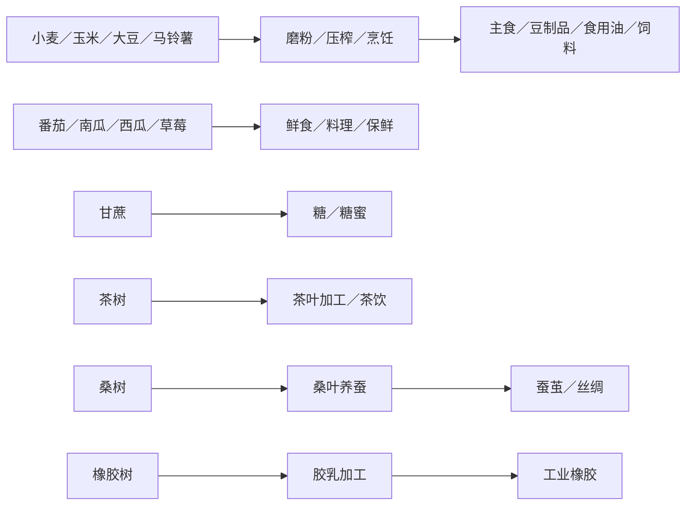

# TerraFlat 必要新增作物与食物产业链总表（最小候选）

> 2026-11-06 依据项目现有物品记录与 `03_生存制作与农业/食物.md` 整理。
> **状态：仅为待做候选，不代表已经实装。** 从最初 198 种、上轮 56 种缩减为 **12 种**；本轮删除 44 种。目标是用尽量少的新增作物支撑核心食物与工业加工，而不是收集现实中的全部作物。

## 一、为什么只保留这 12 种

- **不重复现有内容**：现有水稻、萝卜、辣椒、棉花、浆果、蘑菇，以及苹果、桃、橘、椰子等，不再列为新增项。
- **优先补齐已存在的下游**：已有 `Flour`（面粉）、`Tea`（茶）、`Silk`（丝绸），保留小麦、茶树、桑树，补上生产来源。
- **尊重已有食物策划**：`食物.md` 提到的小麦、草莓、西瓜、南瓜继续保留；水稻已有，不重复新增。
- **一类用途选一个代表**：食用油由大豆承担，基础淀粉由小麦／玉米／马铃薯承担；普通叶菜、香草、其他谷物、坚果、菌菇等不再为“换一种味道”单列物品和种植链。
- **特殊资源须打开独立产线**：保留甘蔗制糖、桑树养蚕、橡胶树产胶；其余复杂工业作物先不做。

## 二、最终保留总览

| 类别 | 数量 | 核心目的 |
|---|---:|---|
| 主粮、蛋白与油脂 | 4 | 主食、豆制品、食用油、饲料 |
| 常见蔬果 | 4 | 烹饪、保鲜、补水、野生驯化 |
| 必要加工链上游 | 3 | 制糖、制茶、养蚕 |
| 工业原料 | 1 | 天然橡胶 |
| **合计** | **12** | **不再为凑类别增加作物** |

## 三、最终新增清单

### 01 主粮、蛋白与油脂（4 种）

| 待新增作物 | 必须保留的作用 |
|---|---|
| 小麦 | 制粉→面包、面条等；补齐已有 `Flour` 的上游 |
| 玉米 | 鲜食、淀粉、牲畜饲料；兼顾食品和畜牧 |
| 大豆（黄豆） | 豆浆、豆腐、酱油、食用油；豆粕作饲料，覆盖大部分豆类与油料用途 |
| 马铃薯（土豆） | 烤制、炖煮、淀粉；提供不同于水稻的块茎主粮 |

### 02 常见蔬果（4 种）

| 待新增作物 | 必须保留的作用 |
|---|---|
| 番茄 | 番茄酱、汤、炖菜；承担基础酱料原料 |
| 南瓜 | 耐储蔬果、熟食、籽与饲料；已有 `食物.md` 策划 |
| 西瓜 | 高水分鲜食，突出食物补水；已有 `食物.md` 策划 |
| 草莓 | 野生采集→驯化种植→果酱；已有 `食物.md` 策划 |

### 03 必要加工链上游（3 种）

| 待新增作物 | 必须保留的作用 |
|---|---|
| 甘蔗 | 榨汁→糖、糖蜜；成为甜品及发酵配方的基础糖料 |
| 茶树（饮料茶） | 采茶叶→制茶；补齐已有 `Tea` 的上游 |
| 桑树 | 桑叶→养蚕→蚕茧→丝绸；补齐已有 `Silk` 的上游。养蚕属于后续独立环节 |

### 04 工业原料（1 种）

| 待新增作物 | 必须保留的作用 |
|---|---|
| 橡胶树 | 采集胶乳→天然橡胶；接入轮胎、密封件等工业制造 |

## 四、只需打通的加工链

- **不为每种作物新建加工系统**：磨粉、压榨、烹饪、保鲜共用配方与制作事务；不同原料通过数据配置及食材标签区分。
- **生长方式仅保留必要差异**：普通耕地作物、草莓野生驯化、茶树／桑树等多年生木本与橡胶树采胶；复用已有生长、种植及果树机制。
- **农业与加工分开**：种子、植株、收获原料、加工成品身份分离；养蚕与橡胶加工属于下游，不直接算作额外作物。
- **新增才算完成**：每项落地仍须补齐物品定义、外观、生成或播种、配方、营养／腐败、多语言和必要测试；本表不表示这些内容已经存在。

## 五、不在本轮新增的内容

其他粮食、豆类、食用油原料、蔬果、坚果、香辛料、药草、纤维植物、水生植物和专用品种菌菇，**全部移出当前候选**。确实需要更多口味时，优先复用现有食材分类、通用菜谱与物品变体；只有未来出现明确的新玩法需求，再单独提出，不预留“可能会用到”的新增名单。
