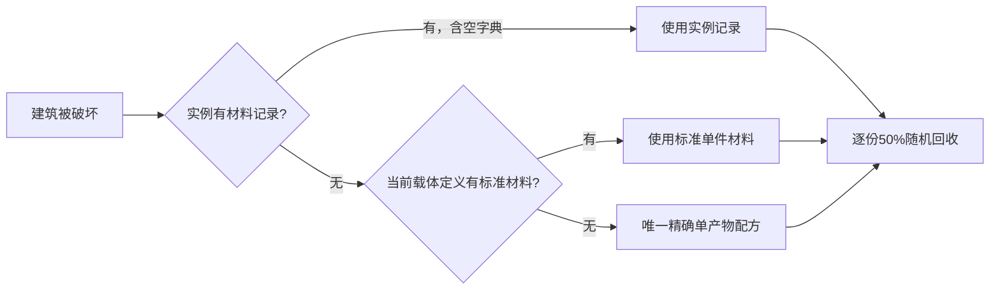

# 可拆除物品材料与制作入口审计（2026-11-04）

范围：启用的 Item Manifest 共500个定义（477个具体物品、23个抽象模板）。按展开继承后的建筑模块 Role 筛选全部109种可放置载体，包含不以 `_Summoner` 结尾的石臼、容器、车辆等；其中16种走格子建筑。天然资源、食物、原料、装备和内部落地本体不因缺少普通配方被机械添加合成。

## 审计结果

| 项目 | 数量 | 处理 |
| --- | ---: | --- |
| 原来已有唯一精确材料配方且可正确回退 | 64 | 保留现有材料、配方和回收 |
| 标签替代料、多配方、批量产物造成无唯一材料来源 | 39 | 具体载体定义补标准单件材料；保留原制作方法 |
| 陶罐只通过烧制得到 | 1 | 按陶罐坯原料声明黏土 ×4 |
| 椰壳错误使用带椰肉副产物的整批投入 | 1 | 标准破壳回收纤维 ×1，不返半个椰子 |
| 创造/GM 专用设备 | 4 | 显式空材料，合法不返料，不开放生存配方 |
| 合计 | 109 | 45种补齐或修正，64种沿用精确配方 |

44种原缺项中有7种格子建筑、37种普通对象；椰壳是额外确认的错误来源。普通可制作建筑不存在缺失制作入口的项目；39种用正式Crafting、陶罐用既有600℃反应，故无需重复新增配方。

## 回收与制作约定

- `Building_Data.CraftingMaterials` 在具体载体定义中是作者声明的标准单件材料；正常纯建筑制作会用真实扣料覆盖它。标准表不是旧实例制作历史的还原。
- 有效实例字典始终优先，空字典表示明确没有可回收材料；非法实例记录继续报错，不被标准表掩盖。
- 标签配方仍接受石头/打制工具、绳子/皮带等替代料；纯建筑产物照旧记录实际物品ID与增产后的单件成本。
- 格子建筑仍不保存逐格材料历史，使用标准表。石墙标准为石头 ×4；铁墙、铁平台、铁地板无历史时采用生铁锭 ×2，保留熟铁替代制作。
- 铁路、木轴、木齿轮按原配方实际批量折算；小数材料依旧按既有期望值抽样，不把每件成本扩大到整批。
- 椰壳的纤维 ×1 是本轮明确设定的植物壳碎料；不把带椰肉的半个椰子当作壳可返材料。含非建筑副产物的制作保留标准表，不能把整批投入全部登记给建筑。
- 锤类完整拆回、50%随机回收概率、真实实例状态传递、品质、替代配方和烧制流程保持原规则。

## 全部补齐与修正清单

表中“标准单件材料”只用于无真实制作记录的回收；“制作方法”列为已经存在且保留的正式入口。零扣量工具不会进入回收表。

| 物品 | 标准单件材料 | 制作方法 |
| --- | --- | --- |
| 铁路 `RailTrack_Summoner` | 生铁锭 ×0.25 + 木板 ×0.5 | 手工/工作台：木板 ×2 + 生铁锭 ×1 → ×4；`crafting/railway.json` |
| 木制独轮手推车 `Wheelbarrow` | 木板 ×6 + 绳子 ×2 + 木棍 ×4 | 工作台：木板 ×6 + 木棍 ×4 + 绳子或皮带 ×2 → ×1；`crafting/wheelbarrow.json` |
| 石臼 `StoneMortar` | 石头 ×1 + 石板 ×1 | 手工/工作台：石板 ×1 + 原石类 ×1 → ×1；至少50次有效制作点击；`crafting/mortar.json` |
| 椰壳 `Coconut_Shell` | 纤维 ×1 | 刀具（不消耗）+ 半个椰子 ×1 → 椰肉 ×1 + 椰壳 ×1；破壳仅回收纤维，不返半个椰子 |
| 手摇轮 `HandCrank_Summoner` | 钻孔木板 ×2 + 钻孔木棍 ×2 + 木制齿轮 ×1 + 绳子 ×1 | 工作台：钻孔木板 ×2 + 钻孔木棍 ×2 + 木制齿轮 ×1 + 绳子或皮带 ×1 → ×1；`crafting/mechanical.json` |
| 风车 `Windmill_Summoner` | 钻孔木板 ×6 + 钻孔木棍 ×4 + 纤维 ×8 + 木制齿轮 ×2 + 绳子 ×4 | 工作台：钻孔木板 ×6 + 钻孔木棍 ×4 + 纤维 ×8 + 绳子或皮带 ×4 + 木制齿轮 ×2 → ×1；`crafting/mechanical.json` |
| 木制传动轴 `Shaft_Wood_Summoner` | 钻孔木棍 ×0.5 | 工作台：钻孔木棍 ×2 → ×4；`crafting/mechanical.json` |
| 木制齿轮 `Gear_Wood_Summoner` | 钻孔木板 ×1 + 钻孔木棍 ×0.5 | 工作台：钻孔木板 ×2 + 钻孔木棍 ×1 → ×2；`crafting/mechanical.json` |
| 离合器 `Clutch_Summoner` | 钻孔木板 ×2 + 木制齿轮 ×1 + 绳子 ×1 + 木制传动轴 ×1 | 工作台：钻孔木板 ×2 + 木制齿轮 ×1 + 木制传动轴 ×1 + 绳子或皮带 ×1 → ×1；`crafting/mechanical.json` |
| 跨轴器 `CrossShaft_Summoner` | 钻孔木板 ×2 + 钻孔木棍 ×2 + 绳子 ×1 + 木制传动轴 ×2 | 工作台：钻孔木板 ×2 + 钻孔木棍 ×2 + 木制传动轴 ×2 + 绳子或皮带 ×1 → ×1；`crafting/mechanical.json` |
| 石磨 `Millstone_Summoner` | 钻孔木板 ×2 + 木制齿轮 ×2 + 石头 ×6 + 木制传动轴 ×1 | 工作台：原石类 ×6 + 钻孔木板 ×2 + 木制齿轮 ×2 + 木制传动轴 ×1 → ×1；`crafting/mechanical.json` |
| 机械风箱 `MechanicalBellows_Summoner` | 钻孔木板 ×4 + 钻孔木棍 ×2 + 木制齿轮 ×1 + 鞣制皮革 ×2 + 绳子 ×2 | 工作台：钻孔木板 ×4 + 钻孔木棍 ×2 + 鞣制皮革 ×2 + 绳子或皮带 ×2 + 木制齿轮 ×1 → ×1；`crafting/mechanical.json` |
| 锯木机 `Sawmill_Summoner` | 钻孔木板 ×4 + 钻孔木棍 ×2 + 木制齿轮 ×2 + 铁板 ×3 + 熟铁钉 ×4 + 木制传动轴 ×1 | 工作台：钻孔木板 ×4 + 钻孔木棍 ×2 + 铁板 ×3 + 木制齿轮 ×2 + 木制传动轴 ×1 + 熟铁钉 ×4 → ×1；`crafting/mechanical.json`；保留全部 4 种既有配方 |
| 机械动力织布机 `MechanicalLoom_Summoner` | 钻孔木板 ×4 + 钻孔木棍 ×2 + 木制齿轮 ×1 + 绳子 ×2 + 木制传动轴 ×1 | 工作台：钻孔木板 ×4 + 钻孔木棍 ×2 + 绳子或皮带 ×2 + 木制齿轮 ×1 + 木制传动轴 ×1 → ×1；`crafting/mechanical.json` |
| 机械锻锤 `MechanicalHammer_Summoner` | 钻孔木板 ×4 + 钻孔木棍 ×2 + 木制齿轮 ×2 + 铁板 ×3 + 熟铁钉 ×4 + 木制传动轴 ×1 | 工作台：钻孔木板 ×4 + 钻孔木棍 ×2 + 铁板 ×3 + 木制齿轮 ×2 + 木制传动轴 ×1 + 熟铁钉 ×4 → ×1；`crafting/mechanical.json`；保留全部 4 种既有配方 |
| 工具柜 `ToolCabinet_Summoner` | 钻孔木板 ×4 + 熟铁钉 ×4 | 工作台：钻孔木板 ×4 + 钉子类 ×4 → ×1；`crafting/mechanical.json` |
| 创造电源 `Creative_Power_Source_Summoner` | 无材料回收 | 创造/GM 目录获取；不增加生存合成 |
| 灯泡 `ElectricLightBulb_Summoner` | 碳丝 ×1 + 铜板 ×1 + 玻璃 ×1 + 熟铁锭 ×1 | 工作台：玻璃 ×1 + 铜板 ×1 + 熟铁锭 ×1 + 碳丝 ×1 → ×1；`crafting/electrical.json`；保留全部 2 种既有配方 |
| 手钻 `HandDrill_Summoner` | 钻孔原木 ×1 + 燧石 ×1 + 绳子 ×2 + 木棍 ×1 | 手工/工作台：木棍 ×1 + 绳子或皮带 ×2 + 钻孔原木 ×1 + 燧石 ×1 → ×1；`crafting/survival.json`；保留全部 2 种既有配方 |
| 高炉 `BlastFurnace_Summoner` | 黏土 ×6 + 熟铁锭 ×2 + 石头 ×12 | 工作台：原石类 ×12 + 黏土 ×6 + 熟铁锭 ×2 → ×1；`crafting/handmade_utilities.json` |
| 木箱子 `Chest_Wood_Summoner` | 木板 ×6 + 绳子 ×4 | 手工/工作台：木板 ×6 + 绳子或皮带 ×4 → ×1；`crafting/buildings.json` |
| 石门 `Door_Stone_Summoner` | 石头 ×6 | 手工/工作台：原石类 ×6 → ×1；`crafting/buildings.json` |
| 木门 `Door_Wood_Summoner` | 木板 ×4 + 绳子 ×1 | 手工/工作台：木板 ×4 + 绳子或皮带 ×1 → ×1；`crafting/handmade_utilities.json` |
| 晾肉架 `Meatrack_Summoner` | 绳子 ×2 + 木棍 ×6 | 手工/工作台：木棍 ×6 + 绳子或皮带 ×2 → ×1；`crafting/handmade_utilities.json` |
| 矿坑入口 `MineEntrance_Summoner` | 原木 ×1 + 石头 ×8 | 手工/工作台：原石类 ×8 + 原木 ×1 → ×1；`crafting/buildings.json` |
| 稻草人 `Scarecrow_Summoner` | 绳子 ×2 + 木棍 ×3 + 干草 ×6 | 手工/工作台：木棍 ×3 + 干草 ×6 + 绳子或皮带 ×2 → ×1；`crafting/handmade_utilities.json` |
| 熔炉 `Smelter_Summoner` | 石头 ×8 | 手工/工作台：原石类 ×8 → ×1；`crafting/buildings.json` |
| 石墙 `Wall_Stone_Summoner` | 石头 ×4 | 手工/工作台：原石类 ×4 → ×1；`crafting/buildings.json` |
| 钻木取火工具 `SparkMaker_Summoner` | 原木 ×1 + 绳子 ×1 + 木棍 ×2 | 手工/工作台：木棍 ×2 + 绳子或皮带 ×1 + 原木 ×1 → ×1；`crafting/buildings.json` |
| 火把 `Torch_Summoner` | 煤矿石 ×1 + 木棍 ×1 | 手工/工作台：煤矿石 ×1 + 木棍 ×1 → ×1；`crafting/survival.json`；保留全部 2 种既有配方 |
| 堆肥箱 `CompostBin_Summoner` | 木板 ×6 + 绳子 ×2 + 木棍 ×2 | 手工/工作台：木板 ×6 + 木棍 ×2 + 绳子或皮带 ×2 → ×1；`crafting/handmade_utilities.json` |
| 草床 `GrassBed_Summoner` | 绳子 ×1 + 干草 ×6 | 手工/工作台：干草 ×6 + 绳子或皮带 ×1 → ×1；`crafting/buildings.json` |
| 石平台 `Platform_Stone_Summoner` | 石头 ×4 | 手工/工作台：原石类 ×4 → ×1；`crafting/ancient_stage.json` |
| 铁平台 `Platform_Iron_Summoner` | 生铁锭 ×2 | 手工/工作台：生铁锭 ×2 → ×1；`crafting/ancient_stage.json`；保留全部 2 种既有配方 |
| 铁墙 `Wall_Iron_Summoner` | 生铁锭 ×2 | 手工/工作台：生铁锭 ×2 → ×1；`crafting/ancient_stage.json`；保留全部 2 种既有配方 |
| 陶罐 `ClayJar` | 黏土 ×4 | 黏土 ×4 → 陶罐坯 ×1；熔炉 ≥600℃ 烧成陶罐（ancient_stage.json） |
| 石地板 `Floor_Stone_Summoner` | 石头 ×4 | 手工/工作台：原石类 ×4 → ×1；`crafting/floors.json` |
| 铁地板 `Floor_Iron_Summoner` | 生铁锭 ×2 | 手工/工作台：生铁锭 ×2 → ×1；`crafting/floors.json`；保留全部 2 种既有配方 |
| 木桶 `WoodenBarrel` | 木板 ×8 + 树脂 ×4 + 绳子 ×4 | 手工/工作台：木板 ×8 + 绳子或皮带 ×4 + 树脂 ×4 → ×1；`crafting/wooden_barrel.json`；保留全部 3 种既有配方 |
| 木制传送带 `Conveyor_Wood_Summoner` | 木板 ×2 + 绳子 ×2 + 木制传动轴 ×1 | 工作台：木板 ×2 + 绳子或皮带 ×2 + 木制传动轴 ×1 → ×1；`crafting/mechanical.json` |
| 创造气罐 `Creative_Gas_Tank_Summoner` | 无材料回收 | 创造/GM 目录获取；不增加生存合成 |
| 水槽 `WaterTrough` | 木板 ×12 + 树脂 ×4 + 绳子 ×4 | 手工/工作台：木板 ×12 + 绳子或皮带 ×4 + 树脂 ×4 → ×1；`crafting/water_trough.json`；保留全部 3 种既有配方 |
| 创造引擎 `Creative_Ship_Engine_Summoner` | 无材料回收 | 创造/GM 目录获取；不增加生存合成 |
| GM重载测试引擎 `ShipChemicalEngine_GM_Summoner` | 无材料回收 | 创造/GM 目录获取；不增加生存合成 |
| 沥青地板 `Floor_Bitumen_Summoner` | 沥青 ×2 + 石头 ×4 | 手工/工作台：原石类 ×4 + 沥青 ×2 → ×1；`crafting/petroleum_utilities.json` |

## 验证与已知覆盖边界

- 新增 `building/material_defaults` Lua 规则：核对全部109种载体覆盖、45份标准表及精确单产物回退候选，明确检查铁路/轴/齿轮单件成本和4种空材料。
- 现有 `material_provenance` 夹具先写入标准木箱材料，再执行真实扣料规则，检查皮带/混料、增产分摊和回收；新增椰壳副产物不覆盖标准材料的生产规则采样。
- 本轮Unity处于PlayMode且另有Agent修改项目，因此不停止游戏、不强制编译、不运行Lua或PlayMode测试。静态目录校验与Luna复查不视为运行通过。
- 静态校验已确认109种材料来源覆盖、45份具体定义表、合法材料引用与标签替代、批量单件折算，未覆盖项为0；`git diff --check` 无格式错误。修改后读取当前Unity控制台：0个错误、11个警告，尚未编译运行本轮代码。
- 无实例时从GameRes当前目录取标准材料的分支、真实格子破坏掉落、联机和保存再载入仍需退出本次游戏后验收；当前运行目录不会因编辑JSON自动更新。
- 未改变SQLite字段编号或快照结构，不迁移开发期旧存档；实例已有真实材料记录继续优先。
- 旧版已保存的椰壳若带 `CraftingMaterials={Coconut_Half:1}`，该错误存量记录仍按实例优先，刷新定义不会替换；本轮仅阻止新制作继续登记半椰子。若需要修复SQLite v1中的这类存量，应另做版本化迁移，本轮未静默覆写既有实例材料。
