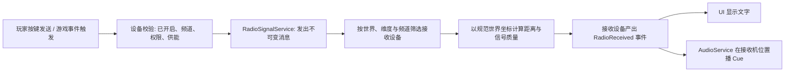

# FlatWorld 无线电通信系统规划（初稿）

## 1. 系统定位与范围

无线电是**游戏世界内的远程信息传输规则**，而不是 Mirror 网络通信或 AudioService 空间声的替代品。它允许玩家、NPC 和设施通过频道发送信息，形成探索求救、队伍协作、远方电台和自动化警报等玩法。

- **第一阶段**：手持对讲机、固定广播电台；开关、频道、有效距离、文字信息、预录提示音及联机同步。单机也能通过事件电台收到广播。
- **后续阶段**：供电与电量深化、广播塔/中继、天线方向、地形遮挡、天气干扰、信道占用、扫描、加密、太空通信。
- **暂不包含**：麦克风实时语音聊天、任意音频文件在线播放、真实电磁波逐帧物理仿真。这三类需求的技术栈与成本不同，不应和首版耦合。

建议把“频道”先定义为稳定整数标识（例如 1～16），不是浮点数 Hz；界面可显示拟真的 MHz 名称，但底层相等比较不受浮点误差影响。实际频道数量和收发范围为**待调平衡参数**。

## 2. 核心数据流

明确区分三个概念：

1. **无线电消息**：游戏规则对象，决定谁可以收到什么。
2. **联机传输**：Mirror 仅传输发送意图和服务端批准的接收结果，不能绕过世界规则。
3. **声音表现**：接收机喇叭的声音从**接收机的位置**播放，而不是从遥远的发射者位置播放；文本 UI 只面向应当看到它的玩家。

## 3. 设备与职责

| 组件（建议新增，尚未实现） | 职责 | 归属现有架构 |
| --- | --- | --- |
| `RadioSignalService` | 发报、频道索引、接收筛选、信号质量、接收事件 | 独立游戏规则服务，按 WorldKey / 维度隔离 |
| `Mod_RadioTransceiver` | 手持设备的开关/频道/状态、装配、收发请求与存档 | Item / Module；由 JSON 定义显式装配 |
| `MachineRadioStationLogic` | 固定电台的通信与电力状态，不能依赖 ChunkView 是否可见 | MachineWorld 数据节点；后续增加 |
| `NetworkRadioBridge` | 客户端请求、服务端身份/持有资格校验和定向接收消息 | Mirror 游戏协议，单机私有 Host 复用同一路径 |
| `RadioMessagePresenter` | 收到信息后的窗口/提示/播放，不参与距离和权限计算 | 现有 UIManager / BasePanel / AudioService |

可保持消息模型极简：`发送者身份 + 频道 + 所属世界身份 + 规范发送位置 + 内容类型 + 内容载荷 + 单次序号`。内容类型先支持**文本**（玩家输入）及**配置消息 ID**（事件、NPC 广播，接收端本地化）；可选 Cue ID 仅在本机音频目录解析，网络不传 AudioClip。

手持无线电首版只在**真正装备或拿在手上、对应模块已加载**时工作。普通背包中的冷 ItemData 不自动成为在线无线电节点；未来若要背包内自动收听，须由库存持有方独立注册设备状态，不能假设未加载物品仍有 MonoBehaviour 在运行。

## 4. 信号规则

### 4.1 第一阶段的最小规则

- 接收资格：收发双方处于**相同世界 / 维度**，接收机开机、调到同一频道、满足供能条件且未处于发射占用状态。
- 距离：通过世界模型的**规范逻辑坐标及环绕拓扑**计算；不可直接用场景 Transform 的欧氏距离，否则环形星球接缝附近会误判。首版在有效半径内能收到，边缘用连续信号质量控制杂音强度。
- 不把“可见区块”“角色视距”“AudioService 的声音最大距离”当作无线电距离。远处的服务端电台即使没有渲染出来，仍可以发送。
- 每条消息只在发送时计算一次接收者；开启/关闭、换频道、设备装卸、世界迁移时更新登记。**不做每帧全世界扫描**。首版设备少，按世界和频道维护字典并遍历同频道节点即可；规模上来后再建空间桶。
- 电量/供电是设备自己的能力。手持机可先用独立持久电量；固定电台以后接 `MachineWorld` 的真实电网供能接口。无线电服务只查询“本次能否供能”，不识别电池或电线的具体类型。

### 4.2 后续拓展

- **中继塔**：收到合法消息后重新发报；消息携序号、最大跳数及已访问设备身份，阻止回路和无限重播。中继自身要实际耗电。
- **障碍与天气**：信号规则可由环境提供衰减系数；优先按冻结的地形/环境数据低频或按次计算，不给每条信号穿越全部 Tilemap 格，更不逐帧射线检测。
- **多频段**：地面短波、长波、太空高增益设备可以共用 `RadioSignalService`，通过不同传播策略扩展；不要让普通电台自动跨维度传输。
- **频道冲突**：首版允许多条已批准消息依序呈现；以后再增加同频同时发报的占用、压制、干扰和优先级规则。

## 5. 游戏内容与交互

**手持对讲机**：右键/使用打开小窗口，可开关机、切换频道、查看信号质量；文本输入通过现有聊天输入能力桥接，但发送前必须经无线电设备校验。发送/接收提示音复用音频 Cue 机制；新音效素材需按 `flatworld-audio` Skill 核实授权和署名。

**固定广播电台**：由 `GameEventManager` 的事件行动或 NPC 行为提供广播内容，电台按同一服务发送，玩家可收到求救、天气预警、故事线索或机械故障警报。事件系统不直接查找玩家 UI，更不直接无条件推送消息。

**玩家体验**：接收到消息时，屏幕显示“频道 + 发报人/台站 + 内容”；若无线电设备实体在玩家附近，其喇叭播放本地空间音效。若接收机被放在远处，不能凭这台机器让玩家无距离地听见声音。

## 6. 联机与存档边界

- 客户端只发送**发报意图**；服务端校验连接身份、真实装备/电台使用权限、开关/频道/电量、冷却、所属 WorldKey 与 RealmRevision，再结算并定向发送消息。拒绝伪造发报设备、越权频道和旧世界代际请求。
- 远端接收者按服务端无线电资格分发，即使发射者不在普通世界物品观察窗口内也能收到。Host 本地不要把本地回调和 Mirror 同步各播放一次。
- 正式持久化的是设备**开关、频道、电量等状态**，装入 Item 的稳定模块实例快照或 MachineWorld 的机器档案。首次发布 MemoryPack 字段顺序需稳定、追加字段保留版本契约。
- 消息作为瞬时事件，不默认存入世界/物品存档；切维度、退出世界、设备卸载时撤销监听和注册，旧消息不得在新世界重播。想做“录音机/历史记录”时另设显式的持久消息收件箱。

## 7. 建议实施顺序

- [ ] **A. 纯规则最小闭环**：同世界/频道注册、发报、距离和接收事件；单元测试覆盖环绕坐标、切频道、关闭设备、跨维度拒收。
- [ ] **B. 可玩手持机**：`Mod_RadioTransceiver`、一个物品 JSON、开关/频道小窗口、文本发送及本地 Cue；覆盖手持卸载/切换/读档不重复订阅。
- [ ] **C. 单机内容**：一个固定电台和一条 `GameEventManager` 触发的求救广播，确认不进入玩家可见区块仍可发送。
- [ ] **D. Mirror**：一个玩家发报、另一个同频道接收；服务端验证权限、距离、世界代际与断线，不受物品观察窗口限制，Host 只表现一次。
- [ ] **E. 后续扩展**：电网、电池材料/配方、中继塔、干扰、频道扫描、太空通信。

## 8. 关键验收场景

1. 两台对讲机同频道且在范围内，能够送达；不同频道、关闭机、超距、不在同一世界/维度时均不能送达。
2. 环形星球两端实际相邻的设备仍按正确拓扑距离通信；放置的接收机发声位置正确。
3. 切换频道、卸下物品、断线、退出世界和读档不会残留注册或重复播放；未接收成功的消息不耗用接收表现资源。
4. 服务端以装备归属和角色实际世界判断合法性；收发双方位于不同可见区块也能通信；单机与 Host/Client 行为一致。
5. 未发生通信时无逐帧候选扫描，无不必要的常驻音源；多设备发报时无跨世界串台。

## 9. 与当前项目的已核实对接点

- 物品：`Assets/5_Scripts/5-3_GamePlay/Entities/Item/Core/Module.cs`、`Presentation/Audio/Mod_AudioEmitter.cs`；模块由 Item 定义装配，加载/卸载负责登记与释放。
- 声音：`Assets/5_Scripts/5-6_Audio/Runtime/AudioService.cs` 已有 Cue、空间声音、声源池与不同音量总线；无线电声音走接收机的本地表现。
- 联机：`Assets/5_Scripts/5-4_Networking/Gameplay/` 下 Mirror 网络玩家、请求权威和世界代际同步；无线电为新的应用层协议，不改普通世界物品距离订阅规则。
- 机器：`Assets/5_Scripts/5-3_GamePlay/World/Machines/` 支持数据机器和外部电网消费者；固定电台不应依附地块视图。
- 事件与 UI：`Core/GameEvents/`、`Presentation/Dialogue/PlayerChatInputController.cs`、`Assets/5_Scripts/5-5_UI/` 可分别提供广播内容、文字输入及显示。

**待确认的玩法选择**：首版主要服务于“玩家间对讲”还是“收听广播/音乐”，以及是否希望背包内开机仍可收听。不同答案影响首个交互入口和冷物品状态处理，但不改变以上核心信号服务设计。
