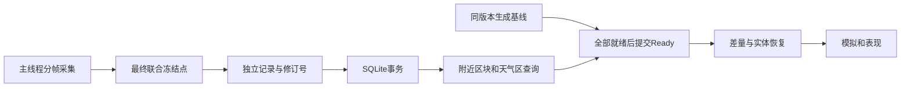

# FlatWorld SQLite 分区存档与按需加载

## 1. 系统定位

正式存档直接替换为 SQLite，开发期 `.bytes` 不迁移、不覆盖、不删除。SQLite v1 是后续兼容起点。玩家只加载附近区块和所需天气区；持续运行的机器、掉落、太空状态仍由原系统持有，启动开销可以随真实后台模拟规模增长。



旧的手工 region 文件方案已由 SQLite 坐标索引取代，不再维护 manifest 文件或整区偏移目录。

## 2. 存储与保存

### 2.1 正式位置与记录

```text
persistentDataPath/Saves/LocalSaveData/<ArchiveId>/save.sqlite
```

- 文件夹使用稳定 GUID；显示名、UTC 时间放元数据。列表、改名、删除、复制与时间均由存档服务处理。
- `Shared/Persistence/ISaveArchiveStore` 隔离驱动，游戏层只提交冻结记录。固定 `unity-sqlite-net 1.3.3`；直接打开文件，不把数据库当 Unity 资产或整库字节载入。
- `archive_records` 按 kind/world/identity 分域，并保存记录版本区间；chunk 使用世界与规范整数坐标索引，weather 使用规范区域身份。实体沿用现有 GUID/船体身份和所属作用域。
- global 保存核心、授权角色与 MOD 元数据；world 保存冻结生成配置等世界资料；chunk 合并地形与生态状态；weather 独立保存共享区域天气；entity/scope 保存机器、掉落、船体与会话头。
- `EcologyWorldSaveData.Chunks` 只作为已加载区块的运行容器，不再作为整世界落盘列表。天气历史也不再随 world 记录整表载入。

### 2.2 修订与事务

- 地形分帧冻结并记录差量版本；最终联合点补冻新增或变化块。玩家、库存、机器、船体、掉落、生态归属同帧捕获。之后的封装不访问活物品或 Unity。
- 新保存意图和最终快照分别登记修订；旧自动任务不能覆盖更新的手动/退出保存。后台只处理冻结字节。
- 区块卸载先进入 session/revision 暂存；成功后才可撤掉唯一解码副本。Commit 只消费冻结点之前的暂存，之后的修改留下一轮。普通读档只读取正式提交，崩溃不发布临时进度。
- 当前和上一逻辑提交共享未变化记录；无变化保存只更新时间，不重写区块。版本回收只删除两代都不再引用的行。
- 永久退役世界通过绑定到同一保存修订的 world removal 删除正式和已暂存身份；失败或被取代的退役候选不混入新保存。
- 需要数据库升级或完整副本时使用 SQLite backup API；自动保存不复制整库。复制生成新档案身份，日常未增加整库压缩或加密。

## 3. 按需流送与预算

- 区块纯生成与 chunk/weather 读盘并行；两者完成后才能 Commit Ready。读盘失败与没有修改记录是不同结果。
- 持久化准备受生成并发上限约束；未启动队列按活动区优先、距离排序，窗口变化重排。等待者独立取消，共享工作仅在无窗口、无租约、无等待者时取消。
- 沿现有显示窗向外预读一圈，活跃模拟与表现租约保持原规则。过时预读可取消；不会为了缓存预算逐出系统仍持有的数据。
- 可逐出缓存只保留冻结字节，Android 为 8MiB/256，Windows 为 32MiB/1024；任一触限逐出。活跃世界、保存中冻结数据与后台模拟数据另计。
- 每档一个串行 I/O worker 和连接，WAL、synchronous=FULL、页缓存目标 2MiB、mmap=0，有界存储队列；脏记录未成功暂存不能逐出。
- 冷地表读取返回 Pending 时，落地、接触、爆炸、流体释放和掉落运动保留待结算状态。冷掉落按固定步消化等待时间，冷→活动交接未结清前保留原记录。
- 区域天气租约随 WorldRuntime，而非场景管理器存活；首次需求增量恢复，最后需求离开先持久化再退出引擎。缓存删除不使其它区域的列表位置索引失效。

## 4. 联机与版本

### 4.1 附近同步

- Gameplay 协议 34：首次包只传必要全局、授权角色、目标世界与观察范围所需太空资料；区块与实体沿观察者窗口分片发送。
- 分片校验世界代际、RealmRevision、请求 token 和快照修订。区块恢复与后续增量顺序衔接；迁移期间需要补全地形，断线、重连和旧响应不能发布到新世界。
- 冷区请求在服务器申请短期 DataRetention，复用正式生成/持久化/实体恢复，再定向发送实时实体和机器基线。客户端初始身份尚未就绪的遗漏通过后续基线请求与 ack 补齐。
- 物品、机器、地形和天气增量均按观察窗口筛选；只回收网络创建的客户端副本，保留公开/私有库存边界。
- 太空客户端下落预览走限定目标与范围的授权请求，读取真实存档地表后发送固定网格，不把未知差量当空地。

### 4.2 发布契约

- SQLite `user_version` 与记录 schema 分开；`ArchiveSchemas` 同时决定写入版本和读取迁移。记录按需迁移，下一次保存写当前格式；必要的未知/未来版本拒绝。
- MemoryPack 发布类型使用固定 Order 和 VersionTolerant；新增字段给显式缺省，已有编号不重排复用，类型或语义变化必须迁移。嵌套物品、模块、机器、地块、decimal、JSON 同样属于契约。
- Item/Inventory/Module 使用保存专用快照；Unity 坐标、渐变键和流体 decimal 采用明确字段。未登记 unmanaged 模块载荷拒绝直写，可注册带 schema/version 的 codec。
- 未知 optional 记录和模块载荷保留原字节，JSON 可选扩展保留原属性；不可支持的必要数据不静默丢弃。
- 移除 FollowCurrent；所有生成入口共用冻结 Profile 内 `flatworld.generation.algorithmVersion=1`。未来改变生成结果新增算法版本。

## 5. 验收记录与待办

### 已有隔离证据

- 排除其它任务改动后的 Git 暂存内容，经 Unity 同版本 Roslyn 离线编译：Persistence、Data、WorldModel、AIECS 及表现/玩法、GamePlay、Networking.Gameplay、GameplayMCP.Editor 共 9 个程序集，0 错误、0 警告。此检查不触发 Editor 导入或运行场景。
- 正式 SQLite 代码与固定版本 Windows 原生驱动的 1千/1万/10万 chunk 点读回归，固定读取窗口，不枚举远区载荷；包含事务失败、暂存隔离、冻结点之后暂存、过期请求、两代快照、退役与 backup/fork。
- `Tools/Tests/SaveArchiveContracts/` 保存首版物品、模块、机器、地形/生态等样本及字段演进、缺省、未来版本拒绝回归。精确覆盖以该目录 coverage.md 为准。
- `Tools/Tests/WorldGenerationV1/` 固定种子覆盖地表/洞穴、无限/环绕的生成哈希；流体和太空既有离线组补充精度、可选字段与身份往返。
- Lua 新增 SQLite 事务修订和 chunk 持久化门禁断言，补充冷掉落待结算及正式隔离数据库保存/前代恢复场景。

### 尚不能视为发布验收完成

- [ ] Unity 全系统快速规则与相关隔离集成实际通过。
- [ ] Host/Client 首次加入、跨窗、切维度、重连、乱序和冷区实体基线的真实双端回归。
- [ ] 玩家、库存、机器、飞船、掉落的完整退出重进、跨区转移与失败写入现场回归。
- [ ] Windows/Android ARM64 IL2CPP 构建及原生插件/裁剪确认；Android 只构建，不默认安装。
- [ ] 固定出生窗口下真实游戏的启动解码数、耗时、峰值内存、缓存和写入量比较；独立数据库分配不等于整游戏峰值内存。

末次 UnityMCP 控制台读取未成功（session not ready / ping 无响应），未清理或中断 Editor。

当前有其它 Agent 并行修改工程，按 AGENTS 规则暂缓 Unity/Lua/PlayMode 和平台验证；不把静态或 .NET 回归记作这些验收通过。待并行工作收口后按 Save/WorldStreaming/Networking/Processing/ItemRuntime/Space/Environment/Fluids 的正式入口执行。
