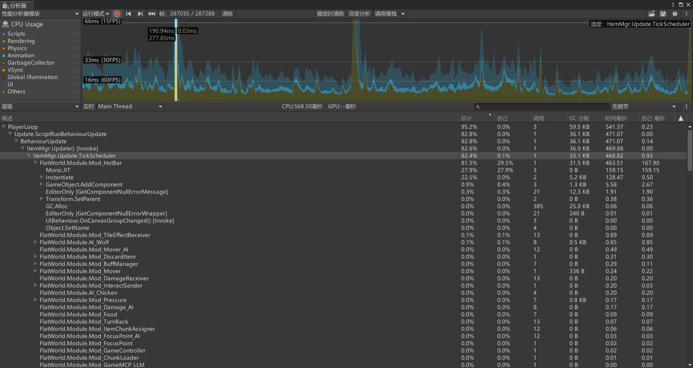

# FlatWorld 性能检查报告与优化顺序

日期：2026-10-18（香港时间）。范围：PC 与安卓。状态：检查结果与优化建议，尚未实施这些改动。

本报告结合当前源码、项目配置、用户提供的 Profiler 截图，以及 Profiler 中已经存在的帧数据。先处理有直接证据的卡顿，再整理大世界、多人和大型基地的扩展瓶颈。优化方向以减少重复工作、改进数据组织和收紧失效范围为主，保持原来的玩法范围与更新频率。

## 1. 先说结论

**用户这次卡顿发生在一次拾取“一堆数量为 200 的雪球”时。现有证据最支持：拾取改变了当前快捷栏槽位，随后创建手持雪球，触发冷首次装配、Awake / OnEnable 和 Mono JIT；雪球第一次执行选格显示时又出现了一次冷首次开销。**

目前没有证据说明游戏创建了 200 个雪球 GameObject。入包代码按槽位批量计算可加入数量，当前样本的 `Instantiate` 一共只有两次。数量 200 会影响重量、体积、容量和最终堆叠数，但不能直接推导出 200 次对象创建。

源码还确认了一处值得直接删除的重复工作：物品池未命中时，工厂先用临时数据装配，再由 ItemMgr 用真实槽位数据装配。应先消除这次重复装配，再考虑少量常用物品的预热。**预热只是把冷成本移到加载阶段，删除重复装配才是减少总工作量。**

持续 CPU 成本方面，感知候选筛选比快捷栏日常更新更值得关注。长期内存方面，液体温度缓存的容量与卸载边界值得先补齐。渲染建议排在后续专项，当前这张截图的主要耗时已经落在具体的 CPU 调用链里。

## 2. 检查基线与证据边界

| 项目 | 本次依据 |
| --- | --- |
| 源码基线 | 分支 `ECSandGo`，检查开始时 HEAD 为 `d81feb632124698675c50a64585191380ab8cf78`，同时读取当前工作区内容 |
| Unity / 渲染管线 | Unity `2022.3.62f3c1`、URP `14.0.12` |
| 其他相关包 | Entities `1.3.8`、Addressables `1.22.3`、项目内 Mirror |
| 用户说明 | 地上一堆数量为 200 的雪球，一次捡入；不是地上 200 个独立掉落实体 |
| 直接帧证据 | 用户截图与对应原始帧 `287035` |
| 对照样本 | 已有 Profiler 缓冲区 `286989～287288`，共 300 帧；只读分析，`record=false` |
| 本轮操作 | 读取文件、配置、Git 历史和已有性能数据，输出本报告及截图副本 |
| 运行边界 | 本轮未主动编译、运行测试、切换或暂停 Play Mode、录制新样本、构建 PC / 安卓；游戏效果由用户验收 |

采样时的具体提交、槽位编号、输入时序和池命中原因没有完整记录。因此，**原始帧能证明哪些方法耗时，当前源码能证明哪些路径存在，两者之间的具体触发条件仍须保留推断标记**。尤其不能把当前盘面所有未提交改动都当成这段采样已运行过的代码。

这 300 帧的末尾还包含明显的编辑器着色器编译、场景加载等长事件：例如 `EditorLoop`、`Shader.EditorCompileVariant`。整段平均帧时间约 153 ms、最大约 19.1 秒，均不适合拿来代表日常游戏帧率。下面优先使用指定帧，以及相关 Marker 出现帧的中位数。不同调用层级的 Total、Self、子调用耗时不能简单相加；`GC.Alloc` 是分配量，也不是垃圾回收停顿时间。[Unity 2022.3 CPU Profiler 说明](https://docs.unity3d.com/2022.3/Documentation/Manual/ProfilerCPU.html)

### 2.1 雪球拾取尖峰的原始证据



| 位置 | Total | Self / 次数 | 可以说明什么 |
| --- | ---: | --- | --- |
| 主线程帧 | 568.50 ms | — | 这一帧发生明显停顿 |
| `ItemMgr.Update.TickScheduler` | 468.82 ms | Self 0.93 ms | 大头在它调度的子工作中 |
| `Mod_HotBar` | 463.51 ms | Self 167.90 ms，调用 1 次 | 手持同步链是这帧首要热点；Self 内部还缺细分 |
| HotBar 子树中的 `Mono.JIT` | 159.15 ms | 3 次 | 含运行时首次编译成本；不同于全帧所有 JIT 的合计 |
| HotBar 子树中的 `Instantiate` | 128.47 ms | 2 次 | 有冷创建，但不是 200 次；内部还包含 Awake 等子调用 |
| `Mod_Snowball.Awake` | 59.84 ms | 1 次 | 本帧确实创建并初始化雪球模块；包含在实例化链中 |
| `Mod_Snowball.OnEnable` | 20.45 ms | 1 次 | 本帧确实启用雪球模块；不能与父调用简单相加 |
| `Mod_Snowball.LateUpdate` | 53.91 ms | 1 次 | HotBar 之外还有雪球首次选格显示的开销 |

`Mod_HotBar` 在 298 个出现帧中的中位数为 **0.0042 ms**，最大 463.51 ms 正是这帧；两次 `Instantiate` 也只在这帧出现。`Mod_Snowball.LateUpdate` 在 252 个出现帧中的中位数为 **0.0450 ms**，最大 53.91 ms 同样在这帧。两者都支持“冷路径尖峰”，不支持把峰值当成每帧固定成本。

截图里 HotBar 的 GC 为 31.5 KB；原始分析包含 EditorOnly 等子样本时会得到更大的包含值。这里沿用截图范围，不把两种统计口径混加。

### 2.2 为什么“一堆 200 个”更像触发条件，而不是 200 倍创建

正式定义 [snowball.json](../../Assets/StreamingAssets/GameConfig/Items/shells/snowball.json) 第 5～35 行：`Snowball` 可堆叠，注册一个 `Module_Snowball` 模块，实际功能是右键铺雪。

[Inventory_Data.cs](../../Assets/5_Scripts/5-1_Data/CoreData/Inventory_Data.cs) 第 654～702 行按槽位循环：已有堆叠通过 `toAdd` 一次加数量，空槽按这一槽能接收的数量创建一份数据。这里不是按 200 个单位循环创建实例；若容量使物品分到多个槽位，工作量主要随实际涉及的槽位数增长。

单机轻量掉落的实际入口 [DroppedItemRuntime.Pickup.cs](../../Assets/5_Scripts/5-3_GamePlay/Entities/DroppedItems/DroppedItemRuntime.Pickup.cs) 第 53～72 行对一条掉落记录克隆一次载荷并写入整堆数量；[Mod_ItemPicker.cs](../../Assets/5_Scripts/5-3_GamePlay/Items/Inventory/Mod_ItemPicker.cs) 第 30～41、389～414 行默认优先快捷栏、再背包，每个目标库存处理整堆剩余量。联机使用完整 Item 权威事务，截图没有记录当时的会话类型，因此不能只凭此段断定本次使用了哪种掉落后端。

[Mod_HotBar.cs](../../Assets/5_Scripts/5-3_GamePlay/Items/Inventory/Mod_HotBar.cs) 第 534～569、1166～1233 行已有事件脏标记、同帧合并和引用复用。只有当前手持实例为空或槽位数据引用变化，才进入创建路径。因此最合理的触发推断是：这次拾取让当前选中槽位获得雪球，下一次快捷栏同步创建手持表现。**当时是否确实选中了空槽、之前是否已有可复用雪球实例，现有证据尚未记录。**

已有同一槽雪球时，`Inventory_Data.ChangeItemDataAmount` 修改的是原有数据的数量，不替换引用。因此单纯“200 增加到 400”通常不会进入同样的首次建壳链。如果这类情形也反复卡顿，后续应查槽位引用是否被其他事务替换、实例是否被卸载或池是否拒收，不能预先归咎于堆叠数量。

[Mod_Snowball.cs](../../Assets/5_Scripts/5-3_GamePlay/World/Environment/Mod_Snowball.cs) 的 `Awake`、`OnLoad`、`OnEnable`、`LateUpdate` 都没有按雪球数量循环。`LateUpdate` 解析一次目标，再按需创建一次选格轮廓。轮廓创建也不能据此解释成 200 次。`Awake` 本身很短，其较大 Total 还包含首次编译等成本，不应按 59.84 ms 去猜一条赋值语句很慢。

Mono 使用 JIT，IL2CPP 使用提前编译。安卓当前配置为 IL2CPP，因此这帧的 159.15 ms Mono JIT 不能直接用于预测安卓耗时；实例创建、模块装配、Awake、资源与显示初始化仍需分别关注。[Unity Mono](https://docs.unity3d.com/2022.3/Documentation/Manual/Mono.html)、[Unity IL2CPP](https://docs.unity3d.com/2022.3/Documentation/Manual/IL2CPP.html)

## 3. 建议执行顺序

P1 表示首批值得处理的项目；P2 表示随后按对应场景推进。条件优先级明确写出，避免让尚未测到的规模风险盖过已经出现的热点。工作量只分小 / 中 / 大，不承诺未经实施确认的天数或收益百分比。

| 编号 | 优先级 | 优化项 | 主要收益 | 证据状态 | 工作量 |
| --- | --- | --- | --- | --- | --- |
| A01 | P1 | 手持冷创建、重复装配与选格框复用 | 操作尖峰、重复建销、临时数据 | 尖峰已确认；重复工作已确认，耗时占比待细分 | 中 |
| A02 | P1 | 感知结果收口的数据化与重复校验消除 | 持续主线程 CPU、批次尖峰 | 现有样本 + 当前源码 | 中到大 |
| A03 | P2，建议先做的小项 | 雪融完后让无工作区块真正退队 | 常态空转、温度快照与队列分配 | 代码路径已确认，收益未量化 | 小到中 |
| A04 | 安卓 P1 / PC P2 | 液体温度缓存有界化与卸载回收 | 长时间探索的存活内存 | 生命周期缺口已确认，占用未量化 | 中 |
| A05 | 条件 P1 / 平时 P2 | 温度几何的精确失效与天气准备阶段 | 雨雪 / 岩浆 / 大加载窗尖峰、GC | 代码路径已确认，当前热点待测 | 中到大 |
| A06 | 条件 P1 | 共享 Flow 的异步发布与局部结构更新 | 导航变更尖峰、图规模增长 | 同步与全表放大链已确认，当前收益待测 | 大 |
| A07 | P2，低成本优先 | HUD 先比较显示值，再本地化和拼文字 | 持续 GC、主线程 | HUD 链有样本，具体分摊待细分 | 小到中 |
| A08 | 联机 P1 | 太空载荷每轮捕获一次，拆分姿态与完整状态 | Host CPU、分配、带宽 | 代码路径已确认，联机耗时未测 | 大，可分阶段 |
| A09 | 大存档 P2 | 保存冻结与编码分离，减少重复编码 | 自动保存停顿、内存峰值 | 主线程编码已确认，当前峰值未测 | 大 |
| A10 | 安卓 GPU P2 | 清晰窗口内跳过透明云层 Pass | GPU 无效像素工作、带宽 | 实际配置与 Shader 已确认，GPU 耗时未测 | 小到中 |

### A01 · 手持创建只装配一次，单独处理首次显示准备

**根因证据：** [ItemObjectPool.cs](../../Assets/5_Scripts/5-3_GamePlay/Entities/Item/Management/Runtime/ItemObjectPool.cs) 第 41～70 行已有按物品 ID 取池。池未命中后，[ItemMgr.Spawning.cs](../../Assets/5_Scripts/5-3_GamePlay/Entities/Item/Management/ItemMgr.Spawning.cs) 第 411～420 行调用 `GameRes.InstantiatePrefab`；[GameRes.cs](../../Assets/5_Scripts/5-3_GamePlay/Core/Lifecycle/GameRes.cs) 第 243～248 行先用 `definition.CreateItemData()` 调用 `ConfigureInstance`。返回 ItemMgr 后，第 95～99 行又绑定真实数据并再次装配。

```text
池未命中 → 创建外壳 → 临时数据装配 → 真实槽位数据装配 → Item.Load
建议改为：池未命中 → 创建外壳 → 真实槽位数据装配 → Item.Load
```

[ItemDefinitionRuntime.cs](../../Assets/5_Scripts/5-3_GamePlay/Entities/Item/Definitions/ItemDefinitionRuntime.cs) 第 67～76、338～389 行表明，两轮都会绑定数据、应用外观、扫描和装配模块。第二轮通常能复用已建立的组件，但第一份临时数据及重复处理仍然存在。

**建议：** 为 ItemMgr 增加明确的内部创建入口，使用最终数据完成一次装配；外部直接使用 `InstantiatePrefab` 的调用者继续获得完整的实例。随后将“取池、外壳创建、模块装配、Load、首次选格显示”分开记录。

**选格框还有可消除的重复建销：** `Mod_Snowball` 第 35～52、67～75 行在卸载 / 禁用时销毁轮廓，再持有时按需新建。[WorldTileTargetOutline.cs](../../Assets/5_Scripts/5-3_GamePlay/Presentation/Interaction/WorldTileTargetOutline.cs) 第 18～24、58～80 行会建立 GameObject、两个组件和专属材质。可在通用目标框表现层提供有界取还，或复用本地玩家的一套轮廓；归还清理 owner 并隐藏，世界退出 / 资源代际变化时释放。目标资格继续由 `WorldSnowInteraction` 管理，通用轮廓不用识别具体物品类型。

再按真正的冷成本决定是否给少量常用手持外壳和通用轮廓做有界预备。预备过程只准备空闲表现，不绑定真实库存、GUID 或启动业务 Tick。这能改善首次操作的停顿位置，但不能替代删除重复工作。

**已有机制与边界：** 当前池已有单类型 24、总数 256 的默认上限、安全回收检查、类型反射缓存及 F5 代际清理。不要重复立项“加一个对象池”或“给已有缓存再加反射缓存”。雪球根 Prefab 本来不带 `Mod_Snowball`，其模块是独立 Prefab，和“两次 Instantiate = 一个外壳加一个模块”的推断吻合；原始样本仍未给出两次调用的具体对象身份。轮廓使用 `new GameObject`，不能把它算作 Object.Instantiate。重复装配究竟占了 167.90 ms Self 的多少，仍未知。

**平台与后续对照：** PC / 安卓都可减少真正重复的装配。分别观察拾取少量和 200 个、首持与第二次切回、已持有同一堆叠时再捡、卸载后再持、F5 后首持。保留拾取总量、合堆、数量显示、铺雪与卸载的原行为；重点看装配次数、池命中原因和冷首次耗时，而不只看平均 FPS。

### A02 · 感知以紧凑索引收口，减少重复跨 Unity 对象验证

**样本：** `ItemMgr.Perception.FilterCandidates` 出现 106 / 300 帧，出现帧中位约 **4.0617 ms**、最高 **35.9327 ms**；Self 累计约 497.72 ms，GC 为 0。这里已经是持续 CPU 问题，不能只盯 GC。

**代码证据：** 正式链路为 `AI_Base.TryRefreshDetector → Mod_ItemDetector.RequestDetectorUpdate → ItemMgr.QueueDetectorQuery → Burst 批次 → 主线程应用`。[ItemMgr.Perception.cs](../../Assets/5_Scripts/5-3_GamePlay/Entities/Item/Management/ItemMgr.Perception.cs) 第 566～612 行对每个候选重复读取活跃状态、GUID、InstanceID、层信息，查询两个注册表，然后才按 Item 去重，并补做 Bridge 精筛与 LOS。

**建议：** 先按 `snapshotIndex` 去重，再读取对象；进一步用紧凑运行时句柄和代际 / 结构修订 / 活跃状态数组收口。同一目标被多个检测器命中时，尽量复用仍有效的身份验证。注册、注销、回池、启停和结构变化更新相应修订。每个 `ApplyDetectorResults` 回调之后必须复核或失效，因为进入 / 离开回调可能销毁、注销或复用对象。

**边界：** 空间哈希、Burst 几何、Native 工作区、List / HashSet 复用、同检测器 LOS 区块寻址缓存都已存在。Filter Self 也不能全归为带子标记的 LOS。先统计候选总数、唯一索引、无效目标与 Bridge 数量，再决定数据化范围；保留完整候选与原感知间隔。

**后续对照：** 同场景、同 AI 数量比较 Filter Self 和候选规模，并检查穿墙、移动、世界接缝，以及回调中删除或回池对象时的结果。PC / 安卓都针对主线程受益。

### A03 · 积雪层存在，不代表这一块仍然有雪

**代码证据：** [WorldWeatherSurfaceSystem.cs](../../Assets/5_Scripts/5-3_GamePlay/World/Environment/WorldWeatherSurfaceSystem.cs) 第 144～147 行用雪环境层“存在”判断有工作；[ChunkTerrainData.cs](../../Assets/5_Scripts/5-0_WorldModel/ChunkTerrainData.cs) 第 607～645 行即使写回 0 也不会删除这一层。[WeatherMgr.Regional.cs](../../Assets/5_Scripts/5-3_GamePlay/World/Environment/WeatherMgr.Regional.cs) 第 308～312 行因此仍捕获温度、入队，之后再全扫 256 格才发现没有活动雪格。

**影响：** 曾经下过雪、现在已经融尽的区块，在晴天仍可能重复付出快照、队列和全格筛选成本。这是另一条雪地常态空转链，不能据此认定它造成了这次手持雪球尖峰。

**建议：** 在雪的统一写入口维护非零计数 / 活动位图；最后一格融化或被铲走后移出活跃集合。无降水时只处理活跃雪格；地形、平台和液体变化按脏格维护。已有 pending 历史账目先结清，恢复世界时重建索引。

**后续对照：** “从未下雪”“下雪后融尽”“最后一格被铲走”三种状态，后两种在无雨无雪后应回到第一种的队列与快照开销水平。PC / 安卓都减少无效工作，实际节省量尚未测量。

### A04 · 温度缓存的存活规模应跟加载范围走

**代码证据：** [LocalTemperatureField.cs](../../Assets/5_Scripts/5-3_GamePlay/World/Environment/LocalTemperatureField.cs) 第 269～270 行持有 `buckets` 和 `sourceChunks`；第 403、486 行随新目标块、来源块加入。当前清理主要依赖世界 / 维度切换和资源代际变化，未发现普通区块逐出时撤源缓存或容量限制。目标桶再次被访问时的局部失效，回收不了永远不再访问的旧区域。

**影响：** 可重建字典、依赖、源列表和权重数组会随访问过的坐标增长。16×16 块中，每个实际温度组的权重有效载荷至少 1024 B，另有对象开销。这里尚未测总内存，不能描述成“全部地形数组泄漏”；地形 Dispose 已有自己的释放逻辑。

**建议：** 源桶随区块逐出撤索引并通知依赖目标，目标桶使用加载窗口约束或有界 LRU，空源否定缓存也有上限。天气工作仍可能借用旧权重，池化数组必须到快照引用结束后才归还。

**后续对照：** 连续探索与返回时，同时看加载块数、两张缓存表计数、权重数量和 Managed Heap；加载规模稳定后，缓存也应有稳定上界。安卓优先，PC 长时间游玩同样受益。

### A05 · 把温度失效收紧到热源，把准备成本纳入完整天气流水线

**代码证据：** [LocalTemperatureField.cs](../../Assets/5_Scripts/5-3_GamePlay/World/Environment/LocalTemperatureField.cs) 第 323、359～379、503～519 行按表层液体版本失效，重建时逐热源扫描整个目标块，并新建分组权重。正式岩浆影响半径为 6 格；普通水变化也可能使同一邻域的热权重重新计算。

[WeatherMgr.Regional.cs](../../Assets/5_Scripts/5-3_GamePlay/World/Environment/WeatherMgr.Regional.cs) 第 298～312 行在同一次天气推进中逐块同步取得温度快照；第 353 行的 2 ms 预算只用于后续 DrainSlice。入队之前的冷权重重建和冻结数据准备不受这段出队预算限制。

**建议：** 热辐射维护自己的源索引和有效修订，只在实际热源改变时失效；每源只更新与其半径包围盒相交的格。把天气步共用的源数值冻结为有所有权的只读快照，几何工作提前增量维护或纳入准备阶段；队列和数组按生命周期复用。两项改动共同减少重复准备，适合一轮设计，但先分开记录耗时。

**边界：** 当前已有稀疏源、单点批次、同温最强值合并、完整区块原子写回。不能再简单建议逐格调用改批次，也不能把温度捕获随意推迟到出队，改变这一笔降水的雨雪判定。[Unity 2022.3 关于集合与数组复用](https://docs.unity3d.com/2022.3/Documentation/Manual/performance-garbage-collection-best-practices.html)

**后续对照：** 大加载窗开始降雨 / 降雪、岩浆附近倒普通水、改变岩浆边界，分别看入队准备和结算时间、`FlatWorld.Temperature.RebuildRadiantLiquidChunk` 的次数及 GC。目标是保留相同温度与相态结果，减少无关重建。

### A06 · Flow 已经用了 Job，发布边界仍会把工作压回主线程

**代码证据：** [FlowNavigationCache.cs](../../Assets/5_Scripts/Shared/Navigation/FlowNavigationCache.cs) 第 132～137、348 行等待读者并在局部 Job 后立即 Complete；[FlowNavigationCache.Publication.cs](../../Assets/5_Scripts/Shared/Navigation/FlowNavigationCache.Publication.cs) 第 48～68 行在区块或出口数量改变时全表重排，第 210～228 行对受影响目标重算宏观路线并当场等待。正式 GO 长路径和 AIECS 都可进入该缓存。

**规模：** 选出口表约按 `目标数 G × 区块数 C × 256` 个整数增长，计算还乘每块出口数量。GO 的旧请求处理虽有默认 2 ms 边界，后面的 Portal 批次调度仍可同步进入这一轮重建。当前没有证据说明这条路径造成了雪球拾取尖峰。

**建议：** 把局部场、宏观路线与选出口串成依赖链，使用“构建中版本 / 已发布版本”统一交换；区块与出口采用稳定槽位或分段表，局部流送变化只修改受影响段。旧快照读取期间继续检查已经变化的可走性。保留安全同步，调整所有权与消费时机，避免直接删除 Complete。[Unity 2022.3 Job 调度与完成](https://docs.unity3d.com/2022.3/Documentation/Manual/JobSystemCreatingJobs.html)

**后续对照：** 多目标连续跨块、动态建拆阻挡时，比较 `FlatWorld.Navigation.Portal.Schedule`、WaitForJobGroupID、全表发布数与高层路线重建数。目标共享、Native 容量复用和无变化直接复用已经存在，后续应在这些机制上扩展。

### A07 · HUD 的去重需要发生在生成文字之前

**样本：** `PlayerWorldCoordinateHUD.RefreshHudCoroutine` 出现 69 帧，Marker 中位 **0.3474 ms**、包含 GC 约 **1,175,980 B**；直接协程路径分配约 **1,097,592 B**。这些数字属于刷新链，不能全部归到某一个格式化函数；末帧场景活动中的峰值也不拿来定性日常成本。

**代码证据：** [PlayerWorldCoordinateHUD.cs](../../Assets/5_Scripts/5-3_GamePlay/Presentation/UI/PlayerWorldCoordinateHUD.cs) 第 227～252 行先 `BuildPressurePresentation()`，再比较旧字符串。构造时已做大气查询、安全 / 呼吸来源本地化，以及 8 参数格式化。[FlatWorldLocalizationService.cs](../../Assets/5_Scripts/5-7_Localization/FlatWorldLocalizationService.cs) 第 301～334 行涉及 key 构造、StringDatabase 查询、params 数组与格式化。

**建议：** 保留 0.1 秒采样，先比较最终显示精度下的温度、气压、安全范围、危险枚举、呼吸来源和缓冲时间。值变化才格式化；语言事件缓存模板与固定标签并使显示缓存失效。这样同时减少字符串、装箱、参数数组和重复本地化，仍即时响应真正变化。

**后续对照：** 原地稳定气压、头盔开合、缓冲倒计时、语言切换时的 HUD 分配与显示。PC / 安卓都受益。当前 HUD 没有逐次拼接全局流送诊断，不应把原因写成不存在的诊断文本。

### A08 · 太空联机先共享本轮冻结载荷，再分别筛选观察者

**代码证据：** [NetworkSpaceStateCoordinator.cs](../../Assets/5_Scripts/5-4_Networking/Gameplay/NetworkSpaceStateCoordinator.cs) 第 194～242 行每 0.2 秒对每个远端连接分别 Capture、JSON、UTF8、GZip、ToArray、再分片分配。[SpaceSession.Networking.cs](../../Assets/5_Scripts/5-3_GamePlay/World/Space/SpaceSession.Networking.cs) 第 164～178 行在观察者过滤之前调用全船内容与散物捕获。

**规模：** 设远端连接数 C、世界载荷规模 N，捕获部分接近 `C × N`；连接后续还分别承担可见内容的序列化和压缩。当前已有距离、世界和对接组过滤，问题是过滤前的全载荷重复捕获，并非完全没有兴趣管理。

**建议：** 第一阶段，同一权威同步轮只捕获一次不可变载荷，按库存 / 模块 / 结构修订复用编码，各连接只做可见性筛选。第二阶段，完整结构与库存采用基线和有版本增量，高频姿态采用紧凑二进制消息，减少 Base64 / JSON / 多层 byte[]。保持发送节奏、大小限制、删除和补拉规则。[Mirror 序列化](https://mirror-networking.gitbook.io/docs/manual/guides/serialization)、[Mirror 同步机制](https://mirror-networking.gitbook.io/docs/manual/guides/synchronization)

**后续对照：** 两人 / 多人观察同船与不同世界，检查每轮捕获次数、编码 CPU、GC、传输字节和客户端解析。安卓 Host 关注捕获与压缩，安卓客户端关注解析与内存。此项尚无本轮联机实测。

### A09 · 自动保存的后台写盘，尚未覆盖前面的主线程编码

**代码证据：** [SaveDataMgr.cs](../../Assets/5_Scripts/5-3_GamePlay/Core/Save/SaveDataMgr.cs) 第 333～346 行先在主线程调用 `BuildCompactSavePayload`，再 `Task.Run` 写盘。第 2658～2684 行继续捕获机器、飞船、散物，对差量排序并逐条序列化。这个结论与既有体检 H05 相同，当前路径仍存在。

**建议：** 主线程只负责把 Unity / 活状态冻结到独立数据，后台负责安全的编码和压缩；未变差量按版本复用编码。统一预算应覆盖捕获与冻结，不把“分帧捕获”当成最后序列化也已异步。只把无 Unity 对象访问的纯数据阶段移到后台，保留保存修订、写入顺序和原子替换。

**后续对照：** 存档规模扩大后的捕获、冻结、编码、写盘分段时间及峰值内存；保存期间继续游玩、连续保存和退出后的最终内容一致。PC 大世界与安卓都适用，当前尚未测得这一版的保存卡顿数值。

### A10 · 云层完全透明时，跳过不产生画面的整屏工作

**代码证据：** 正式 [DefualtURP2D_Renderer.asset](../../Assets/URP/DefualtURP2D_Renderer.asset) 第 82～95 行启用 Zoom Clouds。[ZoomCloudRendererFeature.cs](../../Assets/5_Scripts/5-3_GamePlay/Presentation/Effects/Management/ZoomCloudRendererFeature.cs) 第 130～132、188～200 行提交全屏 Pass；[ZoomClouds.shader](../../Assets/9_Shaders/Resources/Shaders/ZoomClouds.shader) 第 62～75 行先计算三层噪声，再算窗口边缘透明度。清晰窗口内即使最终 alpha 为 0，也已执行这些计算。

**建议：** CPU 使用正式平滑表现窗口，判断视口全部落在清晰矩形内时跳过 Pass；碰到云环时只画覆盖云环的裁剪区域。Shader 可以先剔除确定透明的计算，但噪声含导数，实现时要保持导数有效，不能直接把任意 discard 当成通用手机优化。

**平台与边界：** 该工作随像素数增长，安卓与核显优先。当前没有有效 GPU 耗时，不承诺提升比例，也不把它当成拾取雪球尖峰的根因。后续看完全清晰、云环入画、跨块折返、缩放和宇宙交接时，Pass 是否按需存在且边缘过渡一致。[URP 14 性能配置说明](https://docs.unity3d.com/Packages/com.unity.render-pipelines.universal@14.0/manual/optimize-for-better-performance.html)

## 4. 第二批场景专项

这些代码机会值得记录，但目前证据不足以排在 A01 / A02 前面。

| 编号 | 场景与当前证据 | 具体方向 | 工作量与对照点 |
| --- | --- | --- | --- |
| B01 | 蜜蜂多、花草密集时，[Mod_BeeBehavior.Foraging.cs](../../Assets/5_Scripts/5-3_GamePlay/Entities/AI/Mod_BeeBehavior.Foraging.cs) 第 191～204 行遍历 Placements，每朵候选又经 [GroundCoverSystem.cs](../../Assets/5_Scripts/5-3_GamePlay/World/Map/GroundCoverSystem.cs) 第 49～65 行重扫 Placements，接近 `P + F×P` / 蜂 | 生态所有者维护“本地格 → 原顺序植被候选”和花标签索引；动态可见、占用和预留仍查权威数据 | 中；比较多蜂寻花 CPU，同格多植被、采走、平台 / 水面变化和占位不能漏 |
| B02 | 宏观河图已经共享，但 [DeterministicChunkGenerator.MacroHydrology.cs](../../Assets/5_Scripts/5-0_WorldModel/Generation/DeterministicChunkGenerator.MacroHydrology.cs) 第 29、129 行每生成一块仍扫区域候选和终点 | 宏观图发布时建立河段扩展 AABB 空间桶与终点索引，Chunk 只查询相交候选 | 中；看热缓存下 `river.local_refine`，保留规范坐标、确定顺序与边界指纹 |
| B03 | 接触阴影已经 BRG 合批，但 [ActorShadowManager.cs](../../Assets/5_Scripts/5-3_GamePlay/Presentation/ActorShadowManager.cs) 第 51～95、175～185 行每帧收集；[ContactShadowBatchRenderer.cs](../../Assets/5_Scripts/5-3_GamePlay/Presentation/ContactShadowBatchRenderer.cs) 第 65～103 行清空计数并整批上传。当前 Marker 中位仅 0.0609 ms | 静态机器 / 植物槽位驻留，增删和实际变化时局部上传；动态角色保留动态流，昼夜透明度复用全局参数 | 中；目标为大型基地，比较上传范围与 CPU，检查卸载后无残留 |
| B04 | 建筑网格下游已按脏组上传，上游 [BuildingDepthMeshBridge.cs](../../Assets/5_Scripts/5-3_GamePlay/World/WorldModel/Presentation/BuildingDepthMeshBridge.cs) 第 67～75、121～187 行仍每帧采集全部绑定、矩阵、MPB。当前整个 DepthMesh.Flush 中位仅 0.0225 ms | 用通用表现修订 / 脏通知提交静态建筑；连续动画单独保留连续路径 | 中到大；大型建筑区比较 Unity 属性访问和采集数，保持自定义模块换图 / MPB 的通知完整 |
| B05 | 默认太阳模糊启用，[SunShadowSampling.hlsl](../../Assets/9_Shaders/Shader/SunShadowSampling.hlsl) 第 39～56 行为 5×5，实际进入有效采样的片元最多 25 次本体 Alpha 读取；CPU 投影管理当前中位 0.0383 ms、GC 0，不能代表 GPU 成本 | 研究可复用预滤波 Alpha 图集或合并遮罩滤波，复用静态形状结果；保持图集边缘、半埋裁切、PPU、连续模糊与混合结果 | 大；安卓 / 核显专项，先看树林、农场和晨昏长投影 GPU 数据 |
| B06 | 动物调试显示开启时，`AI_DebugOverlayRenderer.OnGUI` 在这 300 帧分配 813,768 B；[AI_Base.cs](../../Assets/5_Scripts/5-3_GamePlay/Entities/AI/AI_Base.cs) 第 1085～1108、1217～1247 行反复拼 Buff / 状态并量尺寸 | 按状态、Buff 和显示精度变化缓存 GUIContent 与尺寸，先剔除屏外标签 | 小到中；属于开发体验，正式默认关闭，不能算成所有玩家的固定开销 |

## 5. 已有优化应继续复用

- **物品与快捷栏：** 已有事件脏标记、同引用复用、有界对象池、回收资格和资源代际清理。本轮应修冷创建中的重复工作。
- **世界流送与生成：** 已有纯后台生成、代际 / 租约、分阶段绑定、数量与时间预算、取消和预加载 / 保留圈；已有宏观河图，不再是每 Chunk 重新计算完整高分辨率河域。
- **感知与导航：** 已有空间桶、Burst、共享 Flow、Native 工作区、区块寻址和多层失效；方向是减少主线程收口和发布放大。
- **机器与飞船：** 已有机械路由与队列复用、冻结流体工作区、共享罐绑定、增量质量账本和查询索引。本轮 `MachineWorld.Fluid.Complete` 出现帧中位约 0.4521 ms、峰约 3.3353 ms，不支持继续使用旧样本 13 秒峰值作为当前基线。
- **地形、建筑与阴影：** 已有 BRG、区块 / 行网格、GPU 脏范围和源值缓存。提交 `26cba2ac1` 已优化过 BuildingBridge 和太阳投影，旧报告的 26 MB 建筑 GC 不能直接列为当前未修热点。
- **UI、资源与音频：** 背包已有可见槽虚拟化，UI 顶层查询已有修订缓存，资源已有分阶段加载与在途数量限制，音库和声源池已有预热。本轮未发现值得盖过前述项目的明确音频热点。
- **安卓：** 已有 ARM64、IL2CPP、Burst、多线程渲染和 Incremental GC 配置。“打开这些开关”不再是本轮新的优化成果。后处理也有独立质量处理，不能只凭 Quality 档共用 URP 资产就认定所有画质开关无效。

## 6. 实施拆分与用户后续对照重点

建议先做 **A01 → A02**，同时把 A03 作为范围较小、代码证据清楚的清理项；安卓长时间探索再优先 A04。A05 / A06 属于缓存与发布协议调整，分别推进。A07 可以独立实施。多人太空和大存档分别推进 A08 / A09，GPU 项按目标设备数据决定投入。

每轮都应记录：触发场景、冷 / 热状态、工作规模、主线程时间、对应 Marker、GC 与缓存存活量。不能用平均 FPS 掩盖拾取首次尖峰，也不能只让总工作移到另一个函数就算优化完成。

后续如实施系统修改，可按现有 [systems.catalog.json](../../Assets/StreamingAssets/GameplayTests/systems.catalog.json) 选择相应 Lua 范围；本次仅列映射，不运行验收：

| 变更范围 | 已登记系统 | 需要特别保留的流程 |
| --- | --- | --- |
| A01 | `inventory`、`item_runtime` | 一堆 200 个批量入包、合堆、手持身份、铺雪、切槽、回池和资源更新 |
| A02 / A06 | `ai`、`navigation` | 感知回调注销、障碍、跨块 / 接缝、路线发布一致性 |
| A03～A05 | `environment`、`surface_fluids`、`world_streaming` | 最后一格雪、pending、雨雪冻结时刻、液体热源移除与缓存释放 |
| A07 / A10 | `ui_settings`、`rendering`、`localization` | 语言 / 压力变化、平滑云窗、相机缩放、视觉一致性 |
| A08 / A09 | `networking`、`space`、`save` | 多观察者、对接整组、库存、删除 / 补拉、保存原子性与顺序 |

现有 Lua 入口属于部分覆盖；存在系统清单并不等于上述性能边界已经有对应断言。新增实现时再检查缺口。GPU、真机温升、长时间内存、真实多人和视觉效果，本轮均未验收。

## 7. 数据位置与相关文档

本报告保留了关键表格和用户截图。完整原始分析位于本机忽略目录，未纳入本次文档提交：

- 单帧：`.puerts-unity-mcp/perf-reports/profiler_20261017_163736_performance-audit-user-frame287035-20261018/`。
- 300 帧：`.puerts-unity-mcp/perf-reports/profiler_20261017_163754_performance-audit-existing300-20261018/`。
- 两处均包含 `profiler-analysis.json`、CSV 和报告；`20261017_16...` 为工具使用的 UTC 文件名，对应香港时间 2026-10-18 凌晨。

既有 [底层性能架构重构待办](底层性能架构重构待办.md) 中 R01～R05 已有首轮实现记录，其早期耗时不作为今天的固定基线；[项目体检优化重构待办](../00_项目总览与路线/项目体检优化重构待办.md) 还有存档 / 网络等更广的可靠性议题。本报告聚焦本轮性能证据与接下来值得优化的真实路径。
