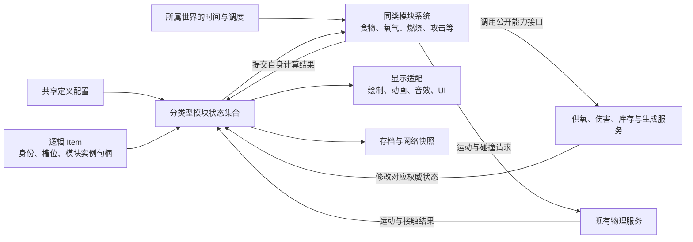

# FlatWorld 模块框架数据化迁移优化规划

## 1. 定位与范围

目标：保留物品按能力组合的方式，把适合批处理的模块迁为“实例数据 + 同类计算系统”，让大量实体的运行成本下降，并让逻辑能够脱离显示对象运行。

迁移按系统逐步交付。每批完成行为回归、真实场景和性能对比后，删除对应旧执行路径。

- 逻辑 Item 保存实体身份、模块槽位与实例句柄；需要 Unity 对象的实体继续使用薄的组件外壳。
- 同类可变数据集中存放，由所属世界的系统计算。
- 输入、动画、绘制、音效和物理通过各自入口协作。
- 优化数据布局、重复查询和计算组织，保持现有模拟频率与玩法规则。
- 不要求兼容旧存档、旧内部 API；保留当前版本正常保存、加载和联网能力。
- 首轮使用普通 C# 连续集合，Job/Burst 作为后续可选项。
- 当前 AI 继续使用 GameObject 主控；本规划不启用 ECS AI，也不重写行为决策。

**状态：2026-10-30 建立规划。本文的迁移阶段尚未执行；已有代码基础单独列在第 2 章。性能基线待采样，不承诺未经实测的提升倍数。**

## 2. 当前基础与迁移缺口

以下为建档时的源码检查结果，后续实施前复查对应入口。

| 现有部分 | 已有基础 | 距离目标的缺口 |
| --- | --- | --- |
| Item / Module | 数据、生命周期、能力索引和 Tick 策略已经存在 | 普通 Item 仍逐个调用模块，热循环没有按能力集中 |
| 生存数值 | `SurvivalNumericBatch` 已提供氧气、气压和体温的纯数值及 Span 入口 | 生产模块仍主要以单实例调用，尚未集中登记同类状态 |
| 营养与燃烧 | `FoodNutritionConsumptionData`、`CombustionFuelDemandData` 已拆出计算函数 | 外部采样、状态提交和事件仍由各模块驱动 |
| 库存能力 | `InventoryModuleDataScheduler`、`ModuleDataRuleRegistry` 已支持无显示组件的数据规则 | 仍按库存和条目执行；跨宿主的统一状态交接需要设计 |
| 自然物 | `NaturalEntityEcsService` 已连接 ECS 模拟、存档与表现 | 复用现有后端，不另建重复的自然物运行时 |
| 掉落物 | `DroppedItemRuntime` 已分开 Tick、Present 和 Capture | 需要与新模块系统明确计时及状态归属，防止重复计算 |
| 数据机器 | `MachineWorld` 已集中推进机器和网络 | 继续保留机器拓扑与库存事务，按需复用模块规则 |

**“函数能接收数组”只代表计算可批处理；只有生产调度真正按同类集合执行，才能算完成批量调度迁移。**

## 3. 目标结构与职责



### 3.1 身份、配置与实例

| 概念 | 用途 | 规则 |
| --- | --- | --- |
| 实体持久身份 | 存档、联网及跨宿主识别 | 复用现有 GUID 与世界账本 |
| ModuleId | 识别模块能力 | 允许多个实例使用同一能力 ID |
| StableName | 区分一个 Item 内的模块槽位 | 保留现有唯一槽位语义 |
| 模块实例句柄 | 定位本次运行的具体状态 | 包含槽位与代际；释放后失效，不写入存档 |
| 共享定义配置 | 容量、消耗率、阈值等 | 同定义共享，只读；资源重载时更新绑定 |
| 实例状态 | 当前氧气、耐久、进度、计时等 | 每个实例独立，由一个明确的执行方维护 |

两个苹果可以共用腐败规则，但腐败进度各自保存。两件衣服可以共用保温配置，但耐久不能共用。

### 3.2 状态存放与读取

- 按能力维护紧凑的类型化集合，初始化和结构变化时登记；热循环直接访问数据。
- 初期优先使用简单结构数组；只有采样证明有收益时，再拆分为多列数组。
- 字符串 ID 用于定义解析、装配和诊断，不用于每个实体每步的反复查找。
- 句柄到数据位置的映射由该能力的数据集合维护；删除时补位并更新映射，外部不缓存裸数组下标。
- 已迁移能力在活动期间以系统状态为权威；对应 ModuleData 通过快照入口捕获状态，不再保持第二份逐帧同步的可写副本。
- 冷态恢复时由快照构建独立状态。库存中仍需持续计时的能力也要登记到明确的调度宿主，不能以“没有 GameObject”为由漏算。
- 迁移某能力时，一并改造它的公开读写入口、保存入口及调用方，避免一部分读新数据、一部分写旧字段。

### 3.3 系统与外部能力

- 系统只负责本能力的计算，跨能力操作复用已有接口。
- 氧气系统管理消耗、供氧和缺氧；气罐管理自身储量，主动调用供氧接口。
- 缺氧伤害调用生命/伤害入口，氧气系统不直接修改血量，也不识别具体装备。
- 腐败、燃尽和寿命到期通过已有库存、替换或生成事务提交，保留失败后可重试的语义。
- 只有多个真实系统共同需要的能力才提取公共接口，不先建立一套通用插件框架。

### 3.4 世界与宿主

- 复用 `GameplayWorldRegistry` 的世界归属，每个世界持有自己的状态集合和时钟。
- Item、库存、掉落物和机器之间转交时，明确交出方、接收方及时间基线，同一段时间只结算一次。
- 世界迁移、物品替换和对象池复用后，旧句柄不能操作新实例。
- 保留现有后台世界与模拟范围规则；本轮不新增离线推进机制，不以不可见代替停止模拟的条件。
- 自然物、机器和掉落物保持当前后端，按实际需要接共享能力接口，不强制转换为完整 Item。

## 4. 调度、表现与持久化

### 4.1 计算阶段


- 该流程是组织方式，各能力保留自己实际需要的阶段，避免空层和重复缓冲。
- 只冻结外部只读输入；可能被同步回调改变的状态，在下一阶段重新读取。
- 当前氧气链存在“扣氧提交 → 回调供氧 → 判断呼吸/缺氧”的顺序，迁移必须保留。
- 对确有跨实体同步依赖的片段保留有序处理；先用 Lua 明确语义，再决定可批处理的边界。
- 调度中的增删、启停和迁移在明确边界更新集合，不能让移除、补位或旧结果覆盖改变本轮应执行的对象。
- 各能力继续使用现有世界时间或 deltaTime 语义。暂停、倒退、跳时和跨世界时钟分别验收。
- 同步接口仍即时修改权威状态；不能把供氧、扣血等公开调用悄悄延后一帧。
- 无持续工作的能力走事件或已有到期机制，不为了统一框架增加全量扫描。

### 4.2 物理与显示

- 物理继续复用 `WorldPhysicsService2D` 等正式入口，模块系统提交运动意图并接收结果。
- 攻击保留动画伤害窗、物理采样和命中结算的现有时序；动画显示偏移不写入逻辑位置。
- 显示组件只管理贴图、动画、特效、音效和 UI；模拟状态不由显示对象的存在决定。
- 输入组件将玩家意图送入正式命令入口，不直接越过系统修改热数据。
- 保留已有批量绘制和按需代理；无需为每个纯数值模块创建 GameObject。

### 4.3 存档、网络与扩展

- 保存从当前权威状态捕获，快照只读且独立，不为保存再次推进计时或触发玩法事件。
- 复用 `ModuleInstanceSnapshot` 和现有编解码入口，保持定义、实例状态与公开网络状态的边界。
- 恢复使用当前定义与持久状态重新登记，运行句柄不跨加载复用。
- 联机保持现有状态权威，远端副本应用公开状态，不重复扣氧、扣燃料或结算伤害。
- 定义重载处理配置绑定和容量变化，已有活实例按明确规则更新，不留下旧数组引用。
- 保留现有 MOD 能力注册入口；尚未迁移的扩展继续使用原入口。每个具体实例只选择一个执行方，不同时运行组件 Tick 和批处理。

## 5. 分阶段迁移清单


顺序用于安排依赖，不代表当前最大耗时排序。氧气先验证框架和同步回调；后续优先级按 S0 实测调整。每阶段都包含对应旧路径清理。

### S0 · 现状与性能基线

- [ ] 列出模块类型、实际实例数、更新频率、状态来源、外部调用和保存入口。
- [ ] 标出纯数值、环境采样、同步回调、物理/动画依赖和只需事件的片段。
- [ ] 确认寿命、食物和燃烧在 Item、库存、轻量掉落及机器中的实际执行方。
- [ ] 建立小量、常用数量和压力数量三档场景，记录实际数量及活动比例。
- [ ] 采集平均帧、P95、模块总 CPU、输入准备、事件提交、GC 和内存基线。
- [ ] 确定首批性能目标及正常数量下允许的测量波动，写入第 7 章。

交付：模块迁移清单、基线报告与首个试点范围；此阶段不改玩法规则。

### S1 · 按世界集中执行氧气

- [ ] 复用 `SurvivalNumericBatch`，增加氧气状态集合与最小实例句柄，不另写一份公式。
- [ ] 在现有世界生命周期中登记、注销及迁移，复用现有实体身份。
- [ ] 将氧气读取、供氧和状态提交入口接到唯一权威状态。
- [ ] 先补供氧回调、多个实例互不干扰、启停、复用和跨世界的 Lua 断言。
- [ ] 把独立数值阶段接入真实同类批量调度，保留供氧回调前后的必要顺序。
- [ ] 同步接入保存、恢复和公开网络采样，验证新状态可被真实调用方读取。
- [ ] 让已登记实例退出旧模块计算，删除被替代的氧气 Tick 主逻辑。
- [ ] 完成规则、真实供氧/缺氧链和三档数量性能对比。

交付：一个生产可用的迁移样板。只有辅助函数支持数组、实际仍逐模块调用时，本阶段不能完成。

### S2 · 气压、体温与营养

- [ ] 复用 S1 的世界归属和登记方式，每种能力保持自己的数据与规则。
- [ ] 迁移气压危险缓冲与伤害计时，保留装备来源组合及撤销规则。
- [ ] 迁移体温传热、水冷和冷热缓冲，环境采样与数值计算分别计时。
- [ ] 迁移营养消耗，食用、移动倍率和 Buff 继续走公开能力入口。
- [ ] 保留死亡、新生命、禁用恢复、临时修正及保存恢复后的状态语义。
- [ ] 每迁完一类就删除其旧计算路径并执行关联回归，不等全部迁完再统一排错。

交付：生存数值由同类系统推进；界面、装备、Buff 和伤害链读取同一状态。

### S3 · 食物计时、寿命与燃烧

- [ ] 复用现有食物计时状态、寿命计算及燃料需求函数，明确每个宿主的唯一执行方。
- [ ] 将适合持续推进的状态分类型登记；事件型和到期型规则保留更合适的执行方式。
- [ ] 打通库存、完整 Item、掉落物和机器库存的状态交接，验收同一时间不重算、不漏算。
- [ ] 腐败、融化、燃尽和寿命到期通过现有正式事务提交，保留替换顺序及失败重试。
- [ ] 燃料与氧气供给仍由供给方管理，不把来源识别写进通用接收模块。
- [ ] 验收世界跳时、暂停、跨世界、堆叠/拆分、快照和独立复制。
- [ ] 清理被替代的每物品轮询及重复计时，不重做自然物或机器后端。

交付：同一能力跨宿主复用规则，实例状态和计时始终只有一个有效执行方。

### S4 · 战斗与运动

- [ ] 先采样攻击、投射物和移动，确定值得迁移的计算段。
- [ ] 将攻击参数、窗口时钟、弹道数值等独立规则与 Transform、动画、碰撞查询拆开。
- [ ] 复用当前命中、伤害、感知和物理接口，不建立第二套伤害结算或碰撞世界。
- [ ] 验收动画伤害窗、连续弹道、同窗去重、环绕接缝及跨世界目标隔离。
- [ ] 验收玩家输入、GameObject AI、手持跟随和远端表现的时序。
- [ ] 只迁移有实际收益的部分；保留有明确 Unity 时序职责的薄组件。

交付：高频计算成本下降，命中结果与操作观感经过真实现场验收；AI 后端选择保持独立。

### S5 · 收敛框架与清理

- [ ] 统一已迁移能力的生命周期、句柄查询、状态捕获和诊断约定。
- [ ] 保留未迁移模块确实需要的 Item/Module 入口，删除仅服务于已移除旧路径的调度和缓存。
- [ ] 删除临时切换开关、重复副本、重复事件桥和已无调用者的旧 API。
- [ ] 将 Item 的逻辑身份与 Unity 显示职责进一步拆清，按实际依赖决定哪些实体需要组件外壳。
- [ ] 更新相关 Skill、系统测试归属与文档，保持说明简短。
- [ ] 完成跨系统回归及正常数量、压力数量、生成/卸载峰值的最终对比。
- [ ] 仅在测量证明有收益时，将没有同步回调依赖的纯数值段迁入 Job/Burst。

交付：保留一套清晰的正式执行路径，后续新增能力可以组合接入。

## 6. 回归与交付要求

依据 [Lua 测试 Skill](../../.agents/skills/flatworld-lua-testing/SKILL.md) 和 [系统目录](../../Assets/StreamingAssets/GameplayTests/systems.catalog.json) 选择实际范围，以下为起点。

| 改动范围 | 主要系统 ID | 必须覆盖的真实链路 |
| --- | --- | --- |
| 登记、句柄、生命周期与调度 | `item_runtime`、`world_streaming`、`save` | 增删、启停、复用、迁移、保存与恢复 |
| 氧气、气压、体温与营养 | `survival`、`environment`、`buff`、`containers` | 真实供氧、缺氧伤害、温度疾病与装备修正 |
| 食物、寿命与燃烧 | `item_runtime`、`survival`、`inventory`、`containers`、`environment` | 库存/落地交接、物品替换、燃料消耗和失败重试 |
| 涉及机器或自然物桥接 | 增加 `mechanical`、`ecology` | 数据后端持续模拟、库存事务与状态唯一性 |
| 战斗、投射物与移动 | `combat`、`player`、`ai`、`navigation` | 攻击窗口、连续弹道、输入与物理时序 |
| 快照、公开状态与扩展 | 增加 `save`、`networking`、`modding` | 最新状态捕获、独立复制、远端不重复结算及扩展单一执行方 |

- 修改前先把正常、边界和关键因果顺序对应到 Lua 断言；缺少的断言先补到所属系统。
- 测试调用生产接口，Lua 检查实际结果；不得在测试夹具里复制计算公式代替验收。
- 新源码和案例同步登记 `systems.catalog.json`。有测试入口不代表完整覆盖，缺口单独记录。
- 保持现有 Lua 文件数和步数预算，优先扩展本系统已有主题。
- 用户正在使用 PlayMode 时不暂停、不停止 Unity，先做静态修改并记录未运行项。
- 可执行时先跑快速规则，影响真实链路再跑集成；完成后检查 Unity 控制台。
- PlayMode 现场按测试 Skill 收集实际截图并查看；纯数据通过不能代替命中、UI 或联网验收。
- 每阶段单独提交任务范围内的代码、资源、测试和必要说明，保留其他工作区修改。

首批命令示例（实施时执行，本次建档未运行）：

```powershell
# 先查看当前目录实际选择的测试与覆盖缺口
python Tools/GameplayTesting/run_suite.py --systems item_runtime survival --plan

# 快速规则
python Tools/GameplayTesting/run_suite.py --systems item_runtime survival

# 涉及真实供氧等链路时执行规则及集成
python Tools/GameplayTesting/run_suite.py --systems item_runtime survival --integration
```

每阶段的完成条件：行为断言通过、需要的现场已验证、性能结果已记录、对应旧路径已清理。受阻或未覆盖的项目保留未勾选。

## 7. 性能验收与待定项

### 7.1 比较方法

- 使用相同构建类型、种子、视距、实体组合、模拟频率、世界时间和输入流程。
- 冷启动、登记/卸载与预热后的稳定运行分开比较；每档至少重复采样三轮。
- 同时记录系统总成本与计算段成本，包含输入准备、集合维护、回调、状态发布和保存捕获。
- 观察平均帧和 P95，也记录峰值；不以减少更新次数或降低模拟范围换取结果。
- 新增诊断点可采用 `FlatWorld.ModuleBatch.<能力>.CollectInputs / Calculate / CommitResults / PublishChanges`，名称属于规划，尚未实现。

| 指标 | 迁移前 | 迁移后 | 验收目标 |
| --- | --- | --- | --- |
| 三档实体数、活动比例和采样时长 | 待采样 | 待采样 | 条件一致，数量明确 |
| 系统总 CPU 平均值 / P95 | 待采样 | 待采样 | 正常规模不退化，压力规模有明确改善；幅度在 S0 填写 |
| 每千活动实例的计算成本 | 待采样 | 待采样 | 随数量增长的成本降低 |
| 纯数值计算段稳定分配 | 待采样 | 待采样 | 预热后 0 B GC；不扩大为整个系统零分配的声明 |
| 完整系统分配与常驻内存 | 待采样 | 待采样 | 记录总量和容量，不隐藏额外副本与缓冲成本 |
| 登记、替换、保存和卸载耗时 | 待采样 | 待采样 | 稳定帧收益没有转移成明显的新峰值 |
| 玩法、快照及网络结果 | 待验证 | 待验证 | 正常流程与关键边界均符合当前规则 |

### 7.2 实施前确定

- [ ] S0 的三档具体数量、场景和性能目标。
- [ ] 每个能力的批处理边界，以及同步回调要求保留的顺序。
- [ ] 纯数据系统的最小登记接口和目录位置，优先沿用现有职责目录。
- [ ] 哪些外部调用方直接读取了旧字段，需要随该能力一起迁移。
- [ ] 完整 Item、库存、掉落物和机器之间的首批交接用例。

## 8. 源码与相关规划

源码目录相对项目根，同一行中的后续文件沿用该目录；类型名和签名以实施时源码为准。

| 入口 | 路径 |
| --- | --- |
| Item 生命周期与模块 Tick | `Assets/5_Scripts/5-3_GamePlay/Entities/Item/Core/Item.cs`、`Module.cs`、`ItemMods.cs` |
| 世界与物品调度 | `Assets/5_Scripts/5-3_GamePlay/Entities/Item/Management/Runtime/WorldItemTickScheduler.cs`、`ItemTickScheduler.cs` |
| 世界归属 | `Assets/5_Scripts/5-3_GamePlay/World/WorldModel/GameplayWorldRegistry.cs` 及其分部 |
| 纯数据规则 | `Assets/5_Scripts/5-3_GamePlay/Entities/Item/Definitions/ModuleDataRuleRegistry.cs` |
| 库存数据调度 | `Assets/5_Scripts/5-3_GamePlay/Items/Inventory/InventoryModuleDataScheduler.cs` |
| 生存数值 | `Assets/5_Scripts/5-3_GamePlay/Entities/Item/Modules/Player/SurvivalNumericBatch.cs` |
| 营养数值 | `Assets/5_Scripts/5-3_GamePlay/Entities/Item/Modules/Player/Food/Logic/FoodNutritionConsumptionData.cs` |
| 燃料需求 | `Assets/5_Scripts/5-3_GamePlay/Entities/Item/Modules/World/CombustionFuelDemandData.cs` |
| 快照 | `Assets/5_Scripts/5-1_Data/ModData/ModuleInstanceSnapshot.cs` |
| 现有数据后端 | `Assets/5_Scripts/5-3_GamePlay/` 下的 `Entities/NaturalECS/`、`Entities/DroppedItems/`、`World/Machines/` |

相关文档：

- [底层性能架构重构待办](底层性能架构重构待办.md)：地形、导航和自然物等专项的整体路线。
- [AI 当前后端与历史 ECS 方案](../02_实体AI与ECS/AI_ECS逻辑与GameObject镜像代理架构待办.md)：以开篇当前结论为准，不自动执行历史全量 ECS 方案。
- [物品模块 Skill](../../.agents/skills/flatworld-item-module/SKILL.md)：实施时维护身份、装配、生命周期和调度边界。
