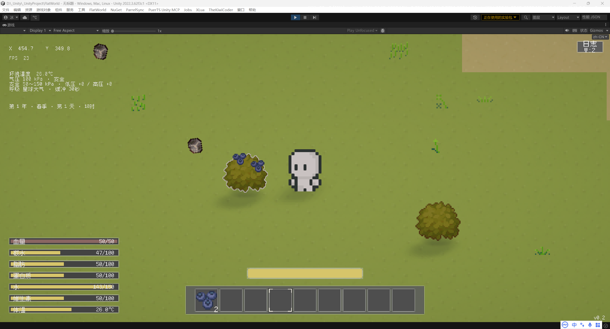

* [ ]  嗯 退出就是玩家退出桌面和退到主菜单那个适合保存的弹窗通知啊就是左边那个按钮不应该是取消而是不保存直接退出就是不保存左边是不保存右边是保存而不是取消
* [ ]  玩家切换了mod的这个排序 或者说是开关 又或者说是MD他的这个嗯哪些是开的 哪些是关的的这个表之后 啊 点击右上角的关闭按钮 会提示玩家是否重启 左边按钮是不重启 右边是重启
* [ ]  嗯 按F拔这个萝卜或者是和这个农户农作物交互 希望他掉下来的时候不要一点反应都没有啊 就你给这个交互的游戏对象啊 给他添加一个这个呃抖动呃抖动吧 不然什么反应都没有 都不知道按了有啥用
* [ ]  现在的脚步声音重复率还是太高了嗯听着三个音就排了一个组合很奇怪呀你看能不能再多搞几个音你可以用这个LMMS给这个脚步声音给他重新编排几个调啊 让走路听起来丰富一 点
* [ ] 玩家每按一次 F 采摘农作物时，都应消耗一点体力值。
* [ ] 玩家翻滚时，需要播放对应的翻滚音效。
* [ ] 使用小刀类工具采集藤蔓等作物时，即使通过攻击将作物击杀，也应掉落与正常采摘一致的资源数量。目前小刀击杀后不掉落，需要修复。例如：藤蔓正常按 F 采摘 5 次掉落 1 个藤蔓；使用小刀击杀后也应掉落 1 个藤蔓（不是 5 个）。
* [ ] 小刀类工具攻击低矮农作物时，应有 50% 的特攻伤害加成：先按正常规则计算目标防御力，得到扣除防御后的伤害，再将该伤害乘以 1.5。加成机制与斧头砍树、镐子敲石头的专属伤害加成类似；不是先增加攻击力再扣防御，也不是小刀攻击所有目标都加伤。
* [ ] 将农作物的血量统一调整为 20 点。
* [ ] 为现有武器、工具及其他装备添加耐久度系统，按材质决定耐久上限：木质较低、石质中等、金属较高。武器或工具每成功造成一次伤害消耗 1 点耐久；未造成伤害不按此规则扣耐久。数值参考：木斧 30 点、青铜斧 1000 点；中间材质由开发时合理分配（建议石斧先按 300 点），铁等更耐用的金属可在青铜基础上进一步提高。非攻击装备的具体耐久消耗方式另行确定。
* [ ] 清理各个 UI 面板中残留的旧版白色箭头素材。素材名称为 `Cursor Direct-19`，预制体中的对应节点名称为 `Image_1`；该箭头已被严重拉伸，显示效果难看且不再需要。请排查各 UI 面板并移除该遗留元素，注意保留其他仍有功能的箭头控件。
* [ ] 黑曜石材质制作的武器统一设置为 50 点耐久（材质较脆，耐久很低），作为通用材质耐久规则的特殊档位。
* [ ] 天气之间增加关联概率：每次区域天气判定结束、生成一种天气后，该天气会影响关联天气的后续触发概率。例如下雨使刮风概率提高约 10%，刮风使雷暴（打雷）概率提高约 10%。这是对原概率区间的偏移，不是直接额外触发天气；建议暂按“基础概率增加 10 个百分点”理解，例如原概率 20% → 30%，并将结果限制在 0%～100%，不跨区域无限累积。同一轮判定中不要无限连锁重复加成。具体是增加 10 个百分点还是相对原概率增加 10%，后续可再确认。
* [ ] 统一检查并调整所有水体 Shader／材质，水面透明度不得低于 50%（即不透明度不高于 50%），避免出现大面积完全遮挡水底的水面。玩家站在水面上、隔着水面也应该清楚辨认水底地块的石头／矿物类型，尤其是黏土等可采集资源；检查不同水体、深度和光照条件下的效果，确保看清地形而不破坏必要的水面表现。
* [ ] 调整布线设施的渲染层级：当前光纤显示在设备上方不合理。光纤应与电线相邻，建议比电线高一级以保证细光纤可见，但必须低于设备；水管、气管较粗，应显示在电线下方。检查这些设施在相互交叉和经过设备时的遮挡关系。
